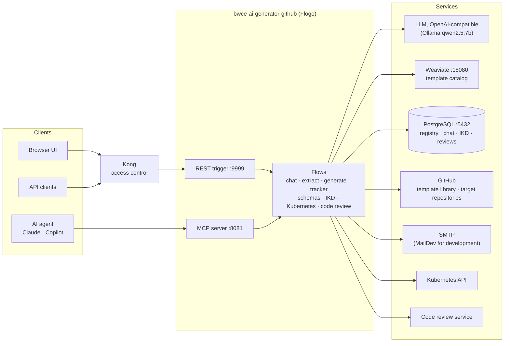
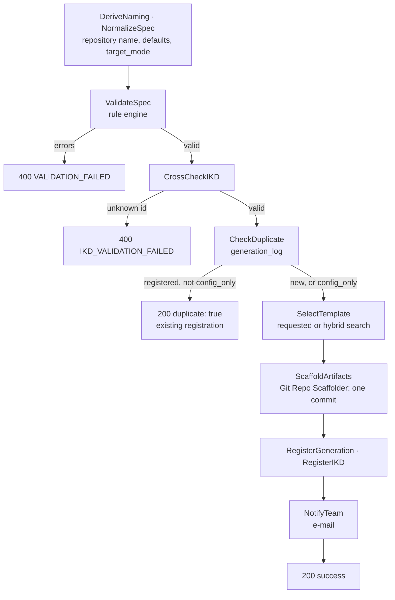

# BWCE AI Generator (TIBCO Flogo)

Generates **TIBCO BusinessWorks Container Edition (BWCE) integration repositories** from plain-English requirements
and publishes them to GitHub. The app is a TIBCO Flogo application, `bwce-ai-generator-github.flogo`: it extracts a
structured integration spec with an LLM, picks the best template of the BWCE template library (`ci-bwcetemplates`,
37 templates) with Weaviate hybrid search, materializes the real project code and publishes it in a single commit.
For the same template revision and spec, its output is byte-identical to the reference Python generator.

It serves a web UI, a REST API (`:9999`) and an MCP server (`:8081`), plus the operations around generated
repositories: generation registry and cleanup, IKD registry, schema upload, Kubernetes status and actions, and code review.

---

## Highlights

- **Conversational or one-shot spec extraction** — a YAML rule engine pre-extracts high-confidence fields, the LLM
  fills in the rest; the chat keeps the spec across turns.
- **Governed generation** — validation rules, the IKD cross-check and duplicate detection run before anything is written.
- **Template selection** — the requested template if it is in the catalog, otherwise Weaviate **hybrid** search
  (BM25 + vector, α 0.25); the chat transcript is passed as context, so hints like "from SFTP" count.
- **Real code in one commit** — the [Git Repo Scaffolder](https://github.com/mpandav-tibco/flogo-custom-extensions/tree/main/activity/gitreposcaffolder)
  activity fetches the template, replaces its tokens, renames paths, adds configuration and CI/CD files and pushes
  one commit: into a folder of a shared repository, or into a new repository per integration.
- **Registry** — every generation is recorded in PostgreSQL together with where it was published; the same spec
  returns the existing registration, and a cleanup endpoint removes a generation again.
- **Operations** — Kubernetes (status, rollout, logs, scale, restart, context switch), code review, XSD/WSDL schema
  upload, IKD export and a notification e-mail per generation.
- **Three front doors** — web UI, REST API (its OpenAPI definition served by Flogo), MCP server for AI agents.

---

## Architecture



Startup (`StartupFlow`) loads the template catalog, the IKD id lists, the operations programs and the Kubernetes
contexts into shared data, creates or upgrades the PostgreSQL tables (`generation_log`, `chat_session`,
`ikd_registry`, `code_review_history`) in one idempotent statement and ingests the catalog into Weaviate.

---

## How a generation works

`POST /generate` (also behind the UI's Generate step and the MCP tool `generate_code`) is a chain of gates; nothing
is written until every gate has passed.



| Gate | Check | On failure |
|------|-------|------------|
| Validation | `rules/spec-validation.yaml`: required fields, repository name ≤ 50 characters, e-mail domain, … | 400 `VALIDATION_FAILED` with details, no writes |
| IKD | `interface_id` / `scenario_id` exist in the IKD lists | 400 `IKD_VALIDATION_FAILED` |
| Idempotency | no registration for the repository name yet (unless `config_only`) | 200 with the existing registration |
| Race safety | `UNIQUE(repo_name)` + `ON CONFLICT` | concurrent duplicates collapse to one row |

A runtime fault (for example PostgreSQL down) is caught by the flow's error handler: 500 `INTERNAL_ERROR` with the
failing activity and message.

**Repository name:** `[in<area>-]src-object-target[-uid][-country]-itype` (product-area prefix map,
`REST_SERVICE`/`SOAP_SERVICE` → `service`).
**Generated content:** `code/<repo>/…` (the template project with its tokens replaced and paths renamed),
`configs/generation.properties`, `configs/generation-metadata.json` and the CI/CD files `.github/workflows/ci.yml`,
`Jenkinsfile`, `k8s/deployment-<env>.yaml` and `config/runtime-<env>.json` (templates in `config/ops-programs.json`,
off with `GENERATE_CICD=false`). `config_only: true` refreshes only `configs/` and keeps the code.
**IKD registry:** every generation registers `<interface_id>:<repo>` / `<scenario_id>:<repo>` in `ikd_registry`
(replacing the repository's previous entry; skipped for config-only).

---

## Where the code is published

| `target_mode` | Result |
|---------------|--------|
| `subfolder` (default) | folder `<repo>/` in the shared repository `TARGET_REPO_URL`, branch `TARGET_BRANCH` |
| `newRepo` | new private repository `<repo>` under `TARGET_OWNER_URL` |

`TARGET_MODE` sets the default; a request overrides it with `target_mode` (REST `/generate`, MCP `generate_code`, UI).
The registry stores where each repository went, so links, duplicate answers, schema uploads and cleanup keep
following the repository when the default changes later.

The repository name is derived from the spec, so **the same spec maps to the same repository**: `/generate` answers
`duplicate: true` with the existing registration and changes nothing. In the UI, a new request after a generation
starts a new conversation.

**New repository from the UI:** describe the integration in the chat, choose **🆕 New repository** after the
product-area step (or type `/newrepo` at any time; `/shared` switches back), then generate; the result links the new
repository.

**Cleanup:** `DELETE /api/tracker/{repo_name}` (UI: `/cleanup <repo>` or **🧹 Clean up repository**) deletes the
folder from the shared repository in one commit and removes the registry and IKD rows. A repository of its own is kept
on GitHub (deleting a repository cannot be undone and needs extra token rights); delete it there by hand.

---

## Web UI

`GET /` serves `static/chat-github.html`, read on every request (UI changes need no rebuild):

- **Chat** with quick prompts and the commands `/templates`, `/suggest`, `/analyze`, `/generate`, `/newrepo`,
  `/shared`, `/upload <repo>` and `/cleanup <repo>`; configuration drawer and schema upload.
- **Repos Generated** — the registry with GitHub links and repository actions: deployment status, code review,
  links to the generated Kubernetes, configuration and Jenkins files, and cleanup. The Jenkins and Fortanix steps
  need the customer's systems.
- **Code Review** and **QAssist** (opens `QASSIST_URL`).

---

## REST API

The API definition (OpenAPI 3) is embedded in the app, and Flogo serves it: start the app with
`FLOGO_EXPOSE_SWAGGER_EP=true` and fetch `GET /api/v2/swagger.json` on the REST port (for Swagger UI, Postman or any
OpenAPI tool).

| Method | Path | Purpose |
|--------|------|---------|
| GET | `/` | Web UI |
| GET | `/health` | Liveness and readiness probe |
| POST | `/api/chat/init`, `/api/chat/message`, `/api/chat/reset` | Conversation that builds the spec (sessions in PostgreSQL) |
| POST | `/extract` | One-shot spec extraction from free text |
| GET | `/api/templates` | Template catalog |
| POST | `/api/templates/suggest` | Ranked templates for a (partial) spec; `/generate` uses the same search |
| POST | `/generate` | Generate and publish (`spec`, `config_only`, `target_mode`) |
| GET | `/api/tracker` | Generated repositories with their GitHub location, the template source and UI settings |
| DELETE | `/api/tracker/{repo_name}` | Clean up a generated repository |
| GET | `/api/ikd?kind=InterfaceIDs\|ScenarioIDs` | IKD registry in the reference `IKD_*.txt` format (`<id>:<repo>` lines) |
| POST | `/api/schemas/upload/{kind}` | Commit XSD/WSDL files into a generated repository (`source`, `target`, `batch`) |
| POST | `/api/codereview/token`, `/api/codereview/run` | Code review token, code review run |
| GET | `/api/codereview/history`, `/api/codereview/network-debug` | Code review history, connectivity check |
| GET | `/k8s/{resource}`, `/k8s/{resource}/{name}`, `/k8s/{resource}/{name}/{view}` | Cluster health, context, status, lists, one item, rollout, logs, port-forward |
| POST | `/k8s/deployments/{name}/{action}`, `/k8s/context/switch` | Scale or restart a deployment, switch the context |

---

## MCP server

Streamable HTTP at `http://<host>:8081/mcp`. VS Code (`.vscode/mcp.json`):

```json
{ "servers": { "bwce-ai-generator": { "type": "http", "url": "http://localhost:8081/mcp" } } }
```

Cursor: `{ "mcpServers": { "bwce-ai-generator": { "url": "http://localhost:8081/mcp" } } }`. Clients that only speak stdio
(for example Claude Desktop) can bridge with `npx mcp-remote http://localhost:8081/mcp`.

| Tool | Arguments | Result |
|------|-----------|--------|
| `extract_spec` | `message` (required), `current_spec` (the spec so far, for follow-up turns) | the extracted spec, missing fields, `ready_to_generate` |
| `generate_code` | `spec` (required: `source_system`, `target_system`, `business_object`, `interface_type`), `config_only`, `target_mode` (`subfolder` or `newRepo`) | the `/generate` result as JSON text: same pipeline, registry and notification |
| `list_templates` | — | the template catalog |

Try the tools interactively with the MCP Inspector: `npx @modelcontextprotocol/inspector`, then connect to
`http://localhost:8081/mcp` (Streamable HTTP).

---

## Operations

All logic is Flogo flows; data-shaped logic (Kubernetes response mapping, request planning, CI/CD rendering) runs
as **jq programs** (TIBCO `json.jq`) loaded at startup from `config/ops-programs.json` into shared data, so one
generic flow serves many endpoints. Only OOTB activities are used (REST Invoke, PostgreSQL, Shared Data,
XML-to-JSON, Mapper) plus the Git Repo Scaffolder. Outbound HTTP goes through two subflows built from the OOTB
**Invoke REST Service** activity, one per target system:

| Subflow | Invokes (method, timeout) | TLS |
|---------|---------------------------|-----|
| `K8sRequest` | `Get` (GET, 30 s), `Patch` (PATCH merge patch, 30 s) | `K8S_INSECURE`, `K8S_CA_CERT` |
| `CodeReviewRequest` | `Probe` (GET, 6 s), `Get` (GET, 25 s), `PostForm` (form POST, 25 s), `PostJson` (JSON POST, 120 s) | `CODE_REVIEW_INSECURE` |

Method, request type and timeout are fixed per Invoke (the designer only offers them as literals), so the subflow
picks the Invoke from its inputs. The Settings URL is the default endpoint; the URL planned at runtime (path and
query) is mapped to the Invoke's `serviceUrl` input, which overrides it. A transport failure (DNS, TCP, TLS,
timeout) takes the error link to `Failed`, so both subflows always return `status`, `text`, `json`,
`content_type`, `elapsed_ms` and `error` (status 0 on a transport failure).

| Area | Endpoints | Notes |
|------|-----------|-------|
| Kubernetes | `GET /k8s/{resource}` (health, context, status, deployments, pods, services, events), `GET /k8s/{resource}/{name}`, `GET /k8s/{resource}/{name}/{view}` (rollout, logs, port-forward), `POST /k8s/deployments/{name}/{action}` (scale, restart), `POST /k8s/context/switch` | Same URLs as the reference; the route selects the operation (`k8s.routes` in `config/ops-programs.json`, anything else is 404). Calls the Kubernetes REST API directly (no kubectl) with the response shapes of the reference; contexts from `K8S_CONTEXTS` (JSON: url, namespace, token; TLS for all contexts from `K8S_INSECURE` and `K8S_CA_CERT`); restrict the `POST` routes (scale, restart, switch) in Kong if only operators may use them |
| Code review | `POST /api/codereview/token`, `POST /api/codereview/run`, `GET /api/codereview/history`, `GET /api/codereview/network-debug` | intginvent token cached in shared data, one retry with a refreshed token, history (newest 500) in PostgreSQL, report links extracted and query strings redacted |
| Schemas | `POST /api/schemas/upload/{kind}` (source, target, batch) | JSON body (`repository_name`, `filename`, `content` / `source_schemas[]`, `target_schemas[]`); XML is validated, files are committed into `<repo>.module/Schemas` or `Service Descriptors` in one commit, a source XSD gets the reference `adidasIntegrationMessage.xsd` wrapper |

---

## Prerequisites

| Component | Default | Notes |
|-----------|---------|-------|
| TIBCO Flogo CLI (`fcli`) | build context `flogo-studio-2268` (Flogo 2.26.8) | with the custom extensions from [flogo-custom-extensions](https://github.com/mpandav-tibco/flogo-custom-extensions): Git Repo Scaffolder, Rule Engine, Weaviate VectorDB connector; Go 1.26 or newer (with `GOTOOLCHAIN=auto`, Go fetches the 1.27.1 toolchain the runtime asks for) |
| PostgreSQL | `localhost:5432`, database `flogo_agent_studio`, user `flogo` | tables are created or upgraded at startup |
| Weaviate | `localhost:18080` | collection `BWCECiTemplates768`, filled from the catalog at startup |
| LLM and embeddings | Ollama at `localhost:11434` with `qwen2.5:7b` and `nomic-embed-text` | `ollama pull qwen2.5:7b`, `ollama pull nomic-embed-text`; any OpenAI-compatible endpoint works |
| GitHub token | environment variable `GITHUB_TOKEN` | Contents read/write on the template library and the target repository; `newRepo` also needs Administration read/write to create repositories |
| SMTP | `localhost:1025` | for development, MailDev: `docker run -d -p 1080:1080 -p 1025:1025 maildev/maildev:2.1.0`, inbox at http://localhost:1080 |
| Kubernetes API (optional) | `K8S_CONTEXTS` | for a local cluster, `kubectl proxy --port=8001` |
| Code review service (optional) | `CODE_REVIEW_BASE_URL` | until `CODE_REVIEW_USERNAME` and `CODE_REVIEW_PASSWORD` are set, the code review endpoints answer 503 |

---

## Build and run

```bash
# once: a build context from the Flogo 2.26.8 VS Code extension package and the custom extensions checkout
fcli create-context -n flogo-studio-2268 -v flogo-vscode-darwin-arm64-2.26.8-3377.vsix -u <path>/flogo-custom-extensions

fcli build-exe -f bwce-ai-generator-github.flogo -c flogo-studio-2268 -n bwce-ai-generator-github -o .
codesign --force --sign - ./bwce-ai-generator-github   # macOS only: ad-hoc signature, or the binary is killed at start
FLOGO_APP_PROPS_ENV=auto FLOGO_EXPOSE_SWAGGER_EP=true GITHUB_TOKEN=<token> ./bwce-ai-generator-github
```

Start it from the repository root: it reads `config/`, `rules/` and `static/` relative to the working directory.
With `FLOGO_APP_PROPS_ENV=auto`, app properties can be overridden with environment variables of the same name (for
example `TARGET_MODE=newRepo`). UI: http://localhost:9999 · API definition: http://localhost:9999/api/v2/swagger.json
(with `FLOGO_EXPOSE_SWAGGER_EP=true`) · MCP: http://localhost:8081/mcp.

---

## Configuration

| Area | App properties (default) |
|------|--------------------------|
| Publishing | `TARGET_MODE` (`subfolder`), `TARGET_REPO_URL`, `TARGET_BRANCH` (`main`), `TARGET_OWNER_URL`, `TEMPLATE_REPO_URL`, `TEMPLATE_REF` (`main`), `GITHUB_TOKEN` (environment only), `GITHUB_API_URL`, `GIT_AUTHOR_NAME`, `GIT_AUTHOR_EMAIL`, `GENERATE_CICD` (`true`) |
| LLM and search | `LLM_BASE_URL`, `LLM_MODEL` (`qwen2.5:7b`), `LLM_EMBEDDING_BASE_URL`, `LLM_EMBEDDING_MODEL` (`nomic-embed-text`), `EXTRACTION_SYSTEM_PROMPT`, `VECTOR_COLLECTION` (`BWCECiTemplates768`), `weaviate.WeaviateTemplateKB.*` (connection) |
| Registry | `PostgreSQL.GenerationRegistry.*` (host, port, database, user, password, pool) |
| Files | `TEMPLATE_REGISTRY` (`config/ci-bwcetemplates.json`), `RULES_PATH` (`rules/`), `IKD_INTERFACES_FILE`, `IKD_SCENARIOS_FILE` (`config/ikd/…`), `OPS_PROGRAMS` (`config/ops-programs.json`), `BRAND_LOGO_FILE` |
| Notification | `SMTP_HOST` (`localhost`), `SMTP_PORT` (`1025`), `NOTIFY_SENDER`, `NOTIFY_RECIPIENTS` |
| Kubernetes | `K8S_CONTEXTS` (JSON: context → `url`, `namespace`, `token`), `K8S_CONTEXT`, `K8S_INSECURE` (`false`), `K8S_CA_CERT` (PEM, base64 PEM or `file:///var/run/secrets/kubernetes.io/serviceaccount/ca.crt`; empty = system CAs) |
| Code review | `CODE_REVIEW_BASE_URL` (placeholder; set it per deployment), `CODE_REVIEW_USERNAME`/`_PASSWORD`/`_USERID`/`_USERTYPE`/`_COOKIE`, `CODE_REVIEW_INSECURE` (`true`: no certificate check, the reference default), `CODE_REVIEW_TOKEN_METHOD` (`POST`; `GET` matches the reference but puts the password in the URL, which the REST Invoke logs) |
| UI and MCP | `QASSIST_URL` (empty: QAssist not configured), `MCP_PORT` (`8081`) |

Secrets (`GITHUB_TOKEN`, database and code review passwords) belong in the environment, not in the `.flogo`.

---

## Verify

```bash
curl -s http://localhost:9999/health
curl -s http://localhost:9999/api/templates | head -c 300
curl -s -X POST http://localhost:9999/generate -H 'Content-Type: application/json' \
  -d '{"spec":{"source_system":"S4HANA","target_system":"KAFKA","business_object":"Article","interface_type":"pub","product_area":"product_area-csddistribution","env":"DEV"}}'
curl -s -X DELETE http://localhost:9999/api/tracker/<repo_name>    # removes a test generation again
```

---

## Access control (Kong)

The UI and the API are exposed through Kong, which authenticates and authorizes every request. The app trusts what
Kong forwards: it has no sign-in, accounts, sessions, roles or audit log, and neither the REST port (:9999) nor the
MCP server (:8081) checks credentials. Reach :9999 only through Kong, and keep :8081 internal or behind Kong as well.
To limit who may scale or restart deployments, switch the Kubernetes context or clean up repositories, restrict the
`POST /k8s/...` and `DELETE /api/tracker/...` routes in Kong (for example with the ACL plugin). A database created by
an earlier version still has the unused account and audit tables; drop them with
`DROP TABLE IF EXISTS public.app_user, public.login_attempt, public.audit_log;`.

---

## Development

`bwce-ai-generator-github.flogo` is the source of truth; change it in the Flogo designer (VS Code) or with the Flogo
design CLI.

**Flow structure.** Every REST handler is an operation of the embedded API definition, one handler per flow, named
after the flow. Each handler maps the request (`pathParams`, `queryParams`, `body`) to the inputs the flow declares,
and the flow's `code` + `responseBody` outputs to the reply. `root_GET` reads the UI file and returns it; the five
Kubernetes endpoints are thin flows over `K8sOperation`. Shared subflows: `ExtractSpecCore` (rules, LLM, JSON clean-up for
`/extract` and the chat), `ScaffoldArtifactsFlow`, `SendNotificationFlow`, `CodeReviewToken`, `RecordCodeReview`,
`K8sRequest` and `CodeReviewRequest`; `/generate` reuses the `/api/templates/suggest` flow for its template search,
so the UI's "best match" is the template it generates. The MCP tools `extract_spec` and `generate_code` run the
`/extract` and `/generate` flows as subflows and `list_templates` reads the same catalog as `/api/templates`, so both
interfaces behave the same.

**Designer validation.** The designer's **Validate** reports no errors in any flow. It resolves every mapped path
against declared schemas and checks each expression's result type, so: the request-body flow inputs (`content`, the
MCP tools' `arguments`) carry the API definition's schema; the `APP_OPS` shared data declares every program key;
query activities list their output columns; `json.jq`/`array.get` results are wrapped in
`coerce.toArray`/`coerce.toString` where the target is typed; link conditions avoid a leading `!(`, which the
designer's expression parser rejects; error branches read `$error[<activity>]`. Each flow's `metadata.fe_metadata`
matches its inputs and outputs (a stale copy makes the designer rewrite flow inputs on save).

**Changing the API.** Add or change the operation in the app's API definition first (Flogo designer, API specs; the
designer offers Method and Path from it), then add the flow and its handler. Flogo's `/api/v2/swagger.json` serves
the result.

### Repository layout

```text
bwce-ai-generator-github.flogo   the Flogo application
config/ci-bwcetemplates.json     template catalog (ingested into Weaviate)
config/ikd/                      IKD interface and scenario id lists
config/ops-programs.json         jq programs: Kubernetes routes and responses, CI/CD file templates
rules/                           rule engine packs: nlu-extraction.yaml, spec-validation.yaml
static/                          web UI (chat-github.html), e-mail logo
```

---

## Differences from the reference generator

Sign-in, accounts, roles and the audit log (Entra ID SSO included) are left to Kong; the code review network check
infers DNS/TCP/TLS from one HTTP probe; rollout status is a snapshot (no blocking wait); schema upload takes JSON
instead of multipart and requires a previously generated repository (404 otherwise); `CODE_REVIEW_INSECURE` replaces
the reference's `CODE_REVIEW_VERIFY_SSL`, because the REST Invoke binds "Disable SSL Verification" to a property, not
an expression.
