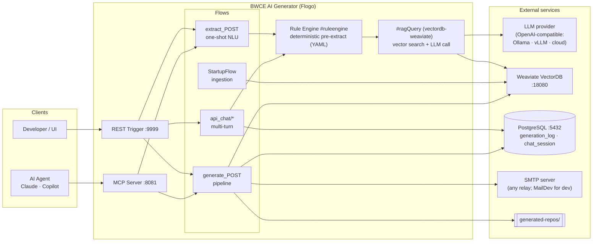
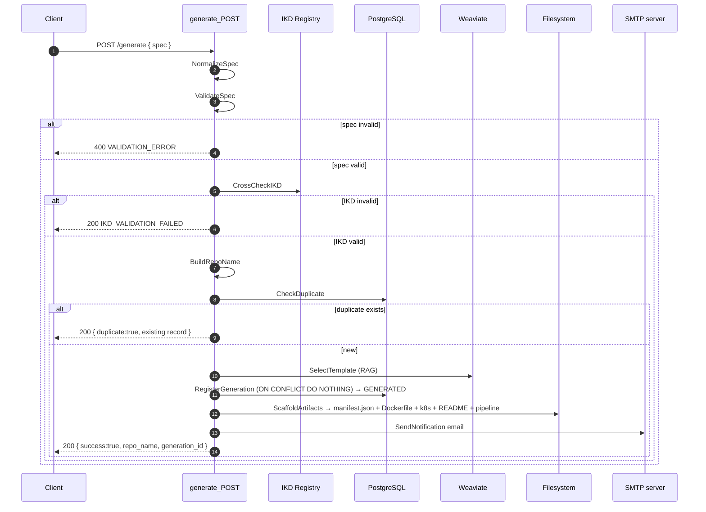
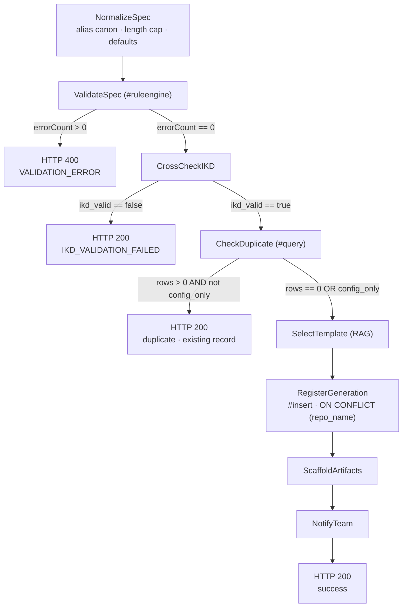

# BWCE AI Generator — Flogo Agentic AI

AI-powered accelerator that generates production-ready **TIBCO BWCE integration repositories** from plain-English requirements, built entirely on **TIBCO Flogo Agentic AI**.

It combines a deterministic rule engine, an LLM for natural-language understanding, Weaviate vector search for template selection, and PostgreSQL for an idempotent generation registry — exposed over both a REST API and an MCP server.

---

## Highlights

- **Conversational & one-shot spec extraction** — describe an integration in English; the system extracts a structured BWCE spec.
- **Deterministic pre-extraction** — a YAML rule engine pulls high-confidence signals (IKD ids, systems, env) before the LLM runs, improving accuracy and making small local models viable.
- **Fence-tolerant JSON parsing** — LLM responses wrapped in prose / ```code fences``` are sanitized before parsing, so models like `llama3.1:8b` work reliably.
- **IKD cross-check** — `interface_id` / `scenario_id` are validated against the IKD registry before anything is generated.
- **Template RAG** — the best-matching template is selected via Weaviate vector search.
- **Idempotent generation** — duplicate specs return the existing record instead of re-scaffolding.
- **Repo scaffolding** + **notification email** on success.
- **Dual interface** — REST API (`:9999`) and MCP server (`:8081`) for Claude / Copilot agents.

---

## Architecture



### `generate_POST` pipeline (the headline flow)



#### Governance gates (decision flow)

The pipeline is a chain of conditional gates — each either lets the request proceed or short-circuits to a reply, so **no side effect happens until every gate passes**:



| Gate | Check | On fail |
|------|-------|---------|
| **Validation** | `ValidateSpec.errorCount == 0` (rule pack) | **400** `VALIDATION_ERROR` — fail fast, no writes |
| **IKD cross-check** | `ikd_valid == true` | **200** `IKD_VALIDATION_FAILED` |
| **Idempotency** | no existing `repo_name` *(unless `config_only`)* | **200** returns the existing record |
| **Race-safety** | `UNIQUE(repo_name)` + `ON CONFLICT DO NOTHING` | concurrent duplicates collapse to 1 row |

> Any runtime fault (e.g. PostgreSQL down) is caught by a flow-level error handler → structured **500** `{error, activity, code}`.

---

## API Endpoints

| Method | Path | Description |
|--------|------|-------------|
| GET  | `/` | Web chat UI |
| GET  | `/health` | Health check |
| GET  | `/docs` | Interactive API reference |
| GET  | `/openapi.json` | OpenAPI 3.0 spec |
| GET  | `/api/templates` | List available BWCE templates |
| POST | `/api/chat/init` | Initialize a chat session |
| POST | `/api/chat/message` | Conversational spec extraction |
| POST | `/api/chat/reset` | Reset a session |
| POST | `/extract` | One-shot NLU extraction |
| POST | `/generate` | Generate a BWCE repository |

MCP tools (`:8081`): `extract_spec`, `generate_code`, `list_templates`.

---

## Flows

| Flow | Purpose |
|------|---------|
| `StartupFlow` | Loads the template registry + IKD ids, ingests templates into Weaviate, initializes the PostgreSQL `generation_log` + `chat_session` tables |
| `api_chat/*` | Multi-turn conversational spec gathering (session state persisted in PostgreSQL `chat_session`) |
| `extract_POST` | One-shot NLU extraction (deterministic pre-extract + LLM) |
| `generate_POST` | Validate → IKD cross-check → template RAG → register → scaffold → notify |
| `MCPExtractSpecTool`, `MCPGenerateTool`, `MCPListTemplates` | MCP-exposed tools |

---

## Prerequisites

| Service | Where | Port | Notes |
|---------|-------|------|-------|
| TIBCO Flogo CLI (`fcli`) | host | — | build context `flogo-studio-2264` (2.26.4) |
| PostgreSQL | container `flogo-studio-postgres` | 5432 | db `flogo_agent_studio`, user `flogo` |
| Weaviate | container `weaviate` | 18080 | template RAG collection `BWCETemplates768` |
| **SMTP server** | any relay | 1025 | **MailDev** is the local-dev default (mock SMTP + web inbox at :1080); point `SMTP_HOST`/`SMTP_PORT` at any relay |
| **LLM provider** | any OpenAI-compatible API | 11434 | **Ollama** is the local-dev default (`llama3.1:8b`, `nomic-embed-text`); swap in vLLM, LM Studio, or a cloud LLM |

> **Pluggable backends:** the LLM and the SMTP relay are *not* hard-wired — Ollama and MailDev are only the
> local-dev defaults. Point `LLM_Base_URL` at any OpenAI-compatible endpoint and `SMTP_HOST`/`SMTP_PORT` at any
> SMTP server; nothing else changes.

---

## Quick start (demo)

Two helper scripts under [`demo/`](demo/) bring everything up and walk through the solution.

```bash
# 1. Start every prerequisite (Postgres, Weaviate, MailDev, Ollama) + the app.
#    Add --build to compile the binary first.
./demo/start-demo.sh            # or: ./demo/start-demo.sh --build

# 2. Run the guided, narrated walkthrough (pauses before each step).
./demo/run-demo.sh              # or: ./demo/run-demo.sh --auto

# Stop the app + MailDev when finished (shared services stay up).
./demo/start-demo.sh --stop
```

Once running:

- REST API → http://localhost:9999
- MCP server → http://localhost:8081
- MailDev inbox → http://localhost:1080
- App log → `/tmp/bwce-ai-generator.log`

---

## Build (manual)

```bash
fcli build-exe -f bwce-ai-generator.flogo -c flogo-studio-2264 -n bwce-ai-generator -o .
```

## Run (manual)

```bash
./bwce-ai-generator
# REST API on :9999, MCP server on :8081
```

---

## Configuration

App properties (set via Flogo app properties or environment overrides):

| Property | Description | Default |
|----------|-------------|---------|
| `AgenticAI.LLMProvider.LLM_Base_URL` | LLM endpoint — any OpenAI-compatible API (Ollama / vLLM / cloud) | `http://localhost:11434` |
| `LLM_MODEL` | LLM model name (provider-specific) | `llama3.1:8b` |
| `LLM_EMBEDDING_MODEL` | Embedding model | `nomic-embed-text` |
| `VECTOR_COLLECTION` | Weaviate collection | `BWCETemplates768` |
| `RULES_PATH` | Rules directory | `rules/` |
| `TEMPLATE_REGISTRY` | Template list file | `config/templates.json` |
| `SMTP_HOST` / `SMTP_PORT` | Notification relay | `localhost` / `1025` |
| `NOTIFY_SENDER` / `NOTIFY_RECIPIENTS` | Email from / to | `bwce-generator@adidas.com` / `core-integration@adidas.com` |
| `SCAFFOLD_OUTPUT_DIR` | Scaffold output | `generated-repos` |
| `PostgreSQL.GenerationRegistry.Database_Name` | Registry DB | `flogo_agent_studio` |

---

## Test

```bash
# Full REST API test suite (assumes the app is already running on :9999)
bash test/api-test.sh
```

The `generation_log` registry can be reset between demos with:

```bash
docker exec flogo-studio-postgres psql -U flogo -d flogo_agent_studio -c 'TRUNCATE generation_log;'
```

---

## GitHub edition (`bwce-ai-generator-github.flogo`)

A second app generated from this one that produces the **real BWCE code** from the customer template library
(`ci-bwcetemplates`) and publishes it to GitHub in a single commit, using the
[Git Repo Scaffolder](https://github.com/mpandav-tibco/flogo-custom-extensions/tree/main/activity/gitreposcaffolder)
activity. Its output is byte-identical to the reference Python generator for the same template revision and spec.

| Aspect | Behaviour |
|--------|-----------|
| Repository name | `[in<area>-]src-object-target[-uid][-country]-itype`, product-area prefix map and `REST_SERVICE`/`SOAP_SERVICE` → `service`, max 50 chars (400 otherwise) |
| Template selection | Requested template if it exists in the catalog, otherwise Weaviate **hybrid** (BM25 + vector, α 0.25) over the 37-template catalog; the chat transcript is passed as `context` so transport hints ("from SFTP") count |
| Output layout | `<TARGET_REPO_URL>/<repo>/code/<repo>/…` + `<repo>/configs/generation.properties`, `generation-metadata.json` + CI/CD files (below) |
| Target modes | `TARGET_MODE=subfolder` (one shared repo, default) or `newRepo` (one repository per integration under `TARGET_OWNER_URL`) |
| Config-only | `config_only:true` refreshes only `configs/` and keeps the code |
| Extra endpoints | `GET /api/tracker` (registry rows with GitHub links), `POST /api/templates/suggest` (ranked templates) |
| CI/CD files | `.github/workflows/ci.yml`, `Jenkinsfile`, `k8s/deployment-<env>.yaml`, `config/runtime-<env>.json` — byte-identical to the reference `CICDScaffolder`; templates live in `config/ops-programs.json` (`cicd.templates`), off with `GENERATE_CICD=false` |
| IKD registry | Every generation registers `<interface_id>:<repo>` / `<scenario_id>:<repo>` (replacing the repo's previous entry, skipped for config-only) in `ikd_registry`; `GET /api/ikd?kind=InterfaceIDs\|ScenarioIDs` returns the reference `IKD_*.txt` content |
| UI | `static/chat-github.html` — sign-in, chat, templates, tracker + schema upload, Kubernetes, code review and admin tabs |

### Operations (ported from the reference generator)

All logic is Flogo flows; data-shaped logic (Kubernetes response mapping, auth decisions, request planning, CI/CD
rendering) runs as **jq programs** (TIBCO `json.jq`) loaded at startup from `config/ops-programs.json` into
shared data, so one generic flow serves many endpoints. Only OOTB activities are used (REST, JWT, PostgreSQL,
Shared Data, XML-to-JSON, Mapper) plus the Git Repo Scaffolder.

| Area | Endpoints | Notes |
|------|-----------|-------|
| Auth | `POST /api/login`, `POST /api/logout`, `GET /api/session` | Local accounts (bcrypt via pgcrypto), HS256 JWT in an HttpOnly `session` cookie (also accepted as `Authorization: Bearer`), `X-API-Key` = admin, lockout after `AUTH_LOGIN_MAX_ATTEMPTS` for `AUTH_LOGIN_LOCKOUT_SECONDS`. Every other endpoint answers 401 (`UNAUTHENTICATED`) / 403 (`FORBIDDEN`, audited) like the reference guard. Public: `/`, `/health`, `/api/login`, `/api/logout`, `/api/session` |
| Admin | `GET/POST/DELETE /api/users`, `GET /api/auditlog?limit=`, `GET /api/auth/diagnostics` | Users and diagnostics are admin-only; the audit log keeps the newest 2000 entries (login, logout, login_failed, login_locked_out, access_denied, user_upsert, user_delete, k8s_*, code_review_run) |
| Kubernetes | `/k8s/health`, `/k8s/context`, `/k8s/context/switch`, `/k8s/status`, `/k8s/deployments[/{name}[/scale\|/restart\|/rollout]]`, `/k8s/pods[/{name}[/logs\|/port-forward]]`, `/k8s/services`, `/k8s/events` | Calls the Kubernetes REST API directly (no kubectl) with the response shapes of the reference; contexts from `K8S_CONTEXTS` (JSON: url, namespace, token, ca, insecure); scale/restart/switch are admin-only and audited |
| Code review | `POST /api/codereview/token`, `POST /api/codereview/run`, `GET /api/codereview/history`, `GET /api/codereview/network-debug` | intginvent token cached in shared data, one retry with a refreshed token, history (newest 500) in PostgreSQL, report links extracted and query strings redacted |
| Schemas | `POST /api/schemas/upload/{source\|target\|batch}` | JSON body (`repository_name`, `filename`, `content` / `source_schemas[]`, `target_schemas[]`); XML is validated, files are committed into `<repo>.module/Schemas` or `Service Descriptors` in one commit, a source XSD gets the reference `adidasIntegrationMessage.xsd` wrapper |

Consolidation in this edition: the three identical static-file flows are one `static_GET`; the extraction pipeline
duplicated in `/extract` and the chat is one `ExtractSpecCore` subflow; the pass-through `BuildRepoName` task,
the unused `GetAppConfig` lookup, three unused properties and the duplicate import aliases were removed. Shared
subflows: `AuthGuard`, `WriteAudit`, `HttpCall`, `CodeReviewToken`, `RecordCodeReview`.

Build and run:

```bash
fcli build-exe -f bwce-ai-generator-github.flogo -c flogo-studio-2265 -n bwce-ai-generator-github -o .
FLOGO_APP_PROPS_ENV=auto GITHUB_TOKEN=<fine-grained PAT: contents rw> AUTH_API_KEY=<random> \
  BOOTSTRAP_ADMIN_USERNAME=admin BOOTSTRAP_ADMIN_PASSWORD=<initial password> ./bwce-ai-generator-github
AUTH_API_KEY=<same> bash test/e2e-github.sh    # 15 end-to-end checks (writes one folder to the target repo)
AUTH_API_KEY=<same> bash test/e2e-ops.sh       # auth, admin, Kubernetes, code review, schemas, IKD
```

`bwce-ai-generator-github.flogo` is maintained directly (Flogo designer / FDA); it is the source of truth.

Key properties: `GITHUB_TOKEN` (env only, never stored), `TEMPLATE_REPO_URL`, `TEMPLATE_REF`, `TARGET_MODE`,
`TARGET_REPO_URL`, `TARGET_OWNER_URL`, `TARGET_BRANCH`, `GIT_AUTHOR_NAME`, `GIT_AUTHOR_EMAIL`,
`TEMPLATE_REGISTRY=config/ci-bwcetemplates.json`, `VECTOR_COLLECTION=BWCECiTemplates768`.
Operations: `AUTH_ENABLED` (default true), `AUTH_API_KEY`, `SESSION_SIGNING_KEY` (random per process when empty —
set it when running more than one instance), `SESSION_TTL_SECONDS` (7200), `HTTPS_ENABLED` (adds `Secure` to the
cookie), `BOOTSTRAP_ADMIN_USERNAME`/`_PASSWORD`/`_DISPLAY_NAME` (creates the first admin once), `MCP_AUTH_TYPE`
(`None` \| `API Key` \| `JWT Token`) + `MCP_AUTH_TOKEN`, `K8S_CONTEXTS`, `K8S_CONTEXT`, `CODE_REVIEW_BASE_URL`,
`CODE_REVIEW_USERNAME`/`_PASSWORD`/`_USERID`/`_USERTYPE`/`_COOKIE`, `CODE_REVIEW_VERIFY_SSL`,
`CODE_REVIEW_TOKEN_METHOD` (`POST`; `GET` matches the reference but puts the password in the URL),
`OPS_PROGRAMS=config/ops-programs.json`, `GENERATE_CICD`. Secrets belong in the environment, not in the `.flogo`.

Differences from the reference: Entra ID SSO is not ported; passwords must have 8+ characters; the code review
network check infers DNS/TCP/TLS from one HTTP probe; rollout status is a snapshot (no blocking wait); schema upload
takes JSON instead of multipart and requires a previously generated repository (404 otherwise).
