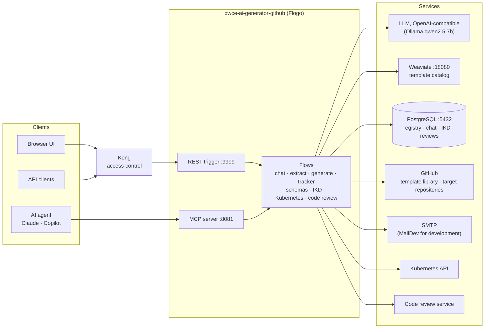
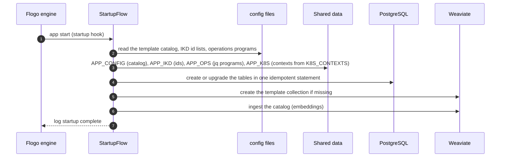
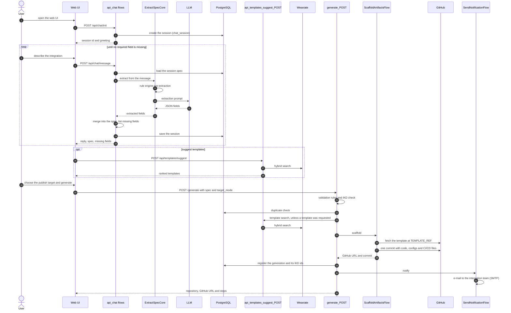
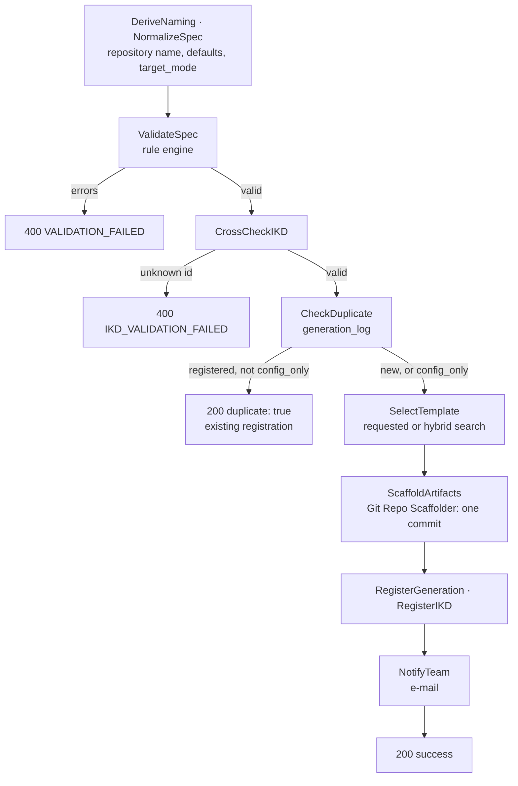
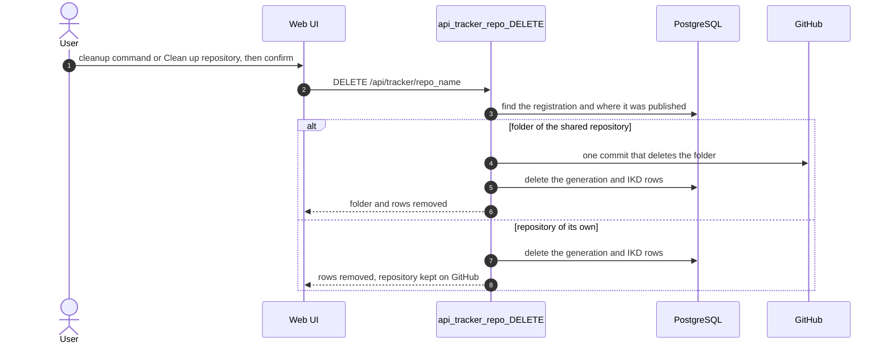
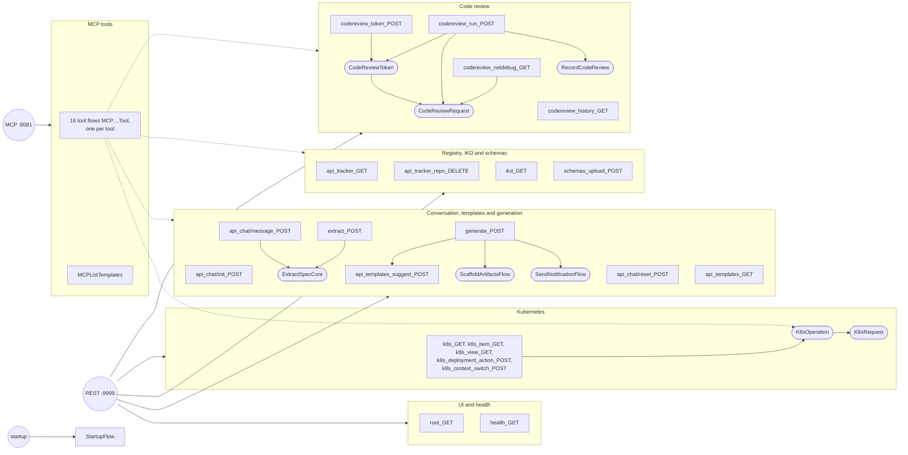
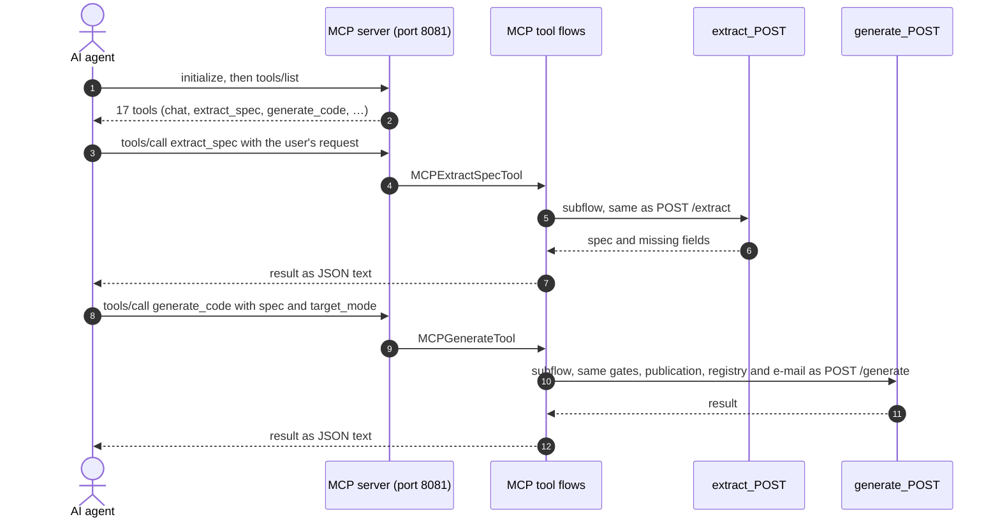
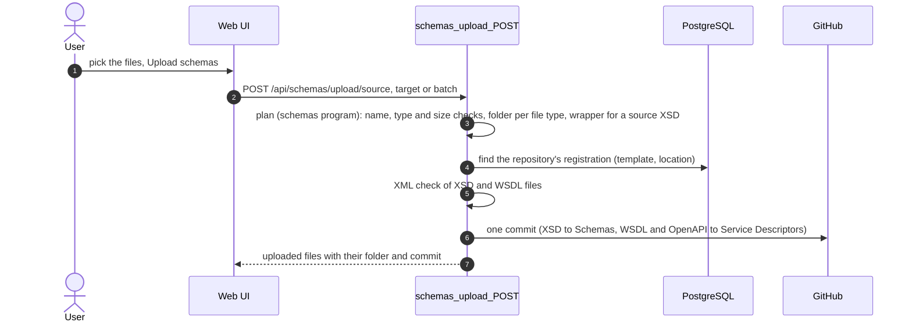
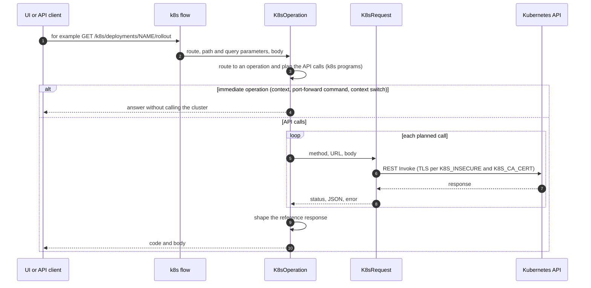
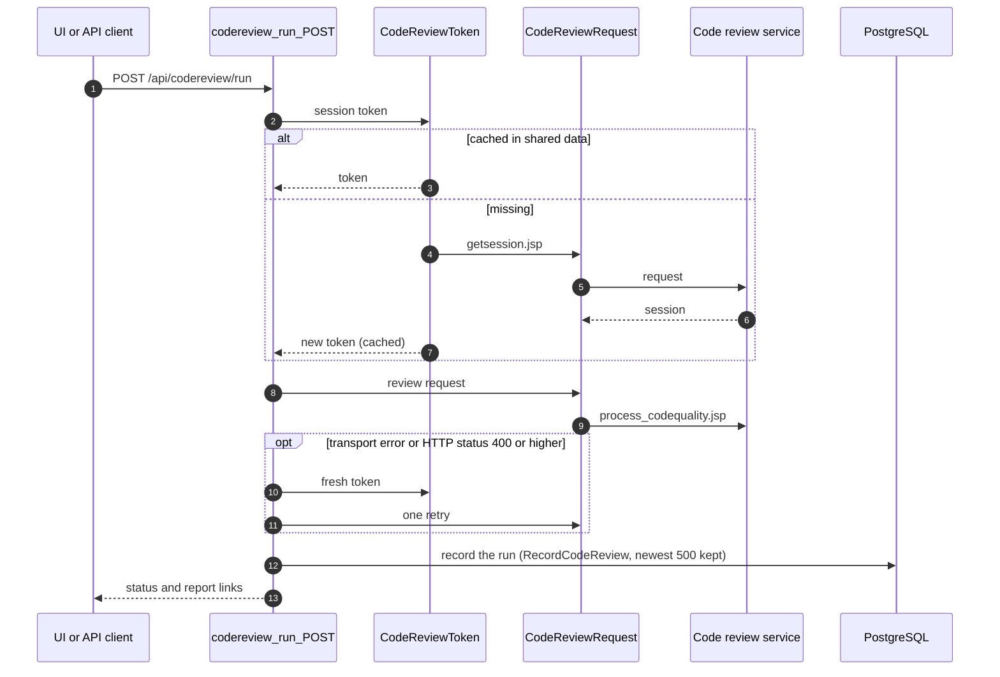

# BWCE AI Generator (TIBCO Flogo)

Generates **TIBCO BusinessWorks Container Edition (BWCE) integration repositories** from plain-English requirements
and publishes them to GitHub. The app is a TIBCO Flogo application, `bwce-ai-generator-github.flogo`: it extracts a
structured integration spec with an LLM, picks the best template of the BWCE template library (`ci-bwcetemplates`,
37 templates) with Weaviate hybrid search, materializes the real project code and publishes it in a single commit.
For the same template revision and spec, its output is byte-identical to the reference Python generator.

It serves a web UI, a REST API (`:9999`) and an MCP server (`:8081`), plus the operations around generated
repositories: generation registry and cleanup, IKD registry, schema upload, Kubernetes status and actions, and code review.

---

## Highlights

- **Conversational or one-shot spec extraction** — a YAML rule engine pre-extracts high-confidence fields, the LLM
  fills in the rest; the chat keeps the spec across turns.
- **Governed generation** — validation rules, the IKD cross-check and duplicate detection run before anything is written.
- **Template selection** — the requested template if it is in the catalog, otherwise Weaviate **hybrid** search
  (BM25 + vector, α 0.25); the chat transcript is passed as context, so hints like "from SFTP" count.
- **Real code in one commit** — the [Git Repo Scaffolder](https://github.com/mpandav-tibco/flogo-custom-extensions/tree/main/activity/gitreposcaffolder)
  activity fetches the template, replaces its tokens, renames paths, adds configuration and CI/CD files and pushes
  one commit: into a folder of a shared repository, or into a new repository per integration.
- **Registry** — every generation is recorded in PostgreSQL together with where it was published; the same spec
  returns the existing registration, and a cleanup endpoint removes a generation again.
- **Operations** — Kubernetes (status, rollout, logs, scale, restart, context switch), code review, XSD/WSDL/OpenAPI schema
  upload, IKD export and a notification e-mail per generation.
- **Three front doors** — web UI, REST API (its OpenAPI definition served by Flogo) and an MCP server that offers
  every feature as a tool, so AI agents can do what a user can.

---

## Architecture



---

## How it works

### Startup

When the app starts, `StartupFlow` prepares everything the request flows read, so no request reads a configuration
file or creates a table:



### From conversation to repository

The typical journey in the web UI: the chat collects the integration spec turn by turn, then `POST /generate`
publishes the repository. API clients do the same with `POST /extract` (one shot) and `POST /generate`; AI agents use
the [MCP tools](#mcp-server).



### Generation gates

`POST /generate` (the UI's Generate step and the MCP tool `generate_code`) is a chain of gates; nothing is written
until every gate has passed.



| Gate | Check | On failure |
|------|-------|------------|
| Validation | `rules/spec-validation.yaml`: required fields, repository name ≤ 50 characters, e-mail domain, … | 400 `VALIDATION_FAILED` with details, no writes |
| IKD | `interface_id` / `scenario_id` exist in the IKD lists | 400 `IKD_VALIDATION_FAILED` |
| Idempotency | no registration for the repository name yet (unless `config_only`) | 200 with the existing registration |
| Race safety | `UNIQUE(repo_name)` + `ON CONFLICT` | concurrent duplicates collapse to one row |

A runtime fault (for example PostgreSQL down) is caught by the flow's error handler: 500 `INTERNAL_ERROR` with the
failing activity and message.

**Repository name:** `[in<area>-]src-object-target[-uid][-country]-itype` (product-area prefix map,
`REST_SERVICE`/`SOAP_SERVICE` → `service`).
**Generated content:** `code/<repo>/…` (the template project with its tokens replaced and paths renamed),
`configs/generation.properties`, `configs/generation-metadata.json` and the CI/CD files `.github/workflows/ci.yml`,
`Jenkinsfile`, `k8s/deployment-<env>.yaml` and `config/runtime-<env>.json` (templates in `config/ops-programs.json`,
off with `GENERATE_CICD=false`). `config_only: true` refreshes only `configs/` and keeps the code.
**IKD registry:** every generation registers `<interface_id>:<repo>` / `<scenario_id>:<repo>` in `ikd_registry`
(replacing the repository's previous entry; skipped for config-only).

---

## Where the code is published

| `target_mode` | Result |
|---------------|--------|
| `subfolder` (default) | folder `<repo>/` in the shared repository `TARGET_REPO_URL`, branch `TARGET_BRANCH` |
| `newRepo` | new private repository `<repo>` under `TARGET_OWNER_URL` |

`TARGET_MODE` sets the default; a request overrides it with `target_mode` (REST `/generate`, MCP `generate_code`, UI).
The registry stores where each repository went, so links, duplicate answers, config-only refreshes, schema uploads and
cleanup keep following the repository when the default changes later.

The repository name is derived from the spec, so **the same spec maps to the same repository**: `/generate` answers
`duplicate: true` with the existing registration and changes nothing. In the UI, a new request after a generation
starts a new conversation.

**New repository from the UI:** describe the integration in the chat, choose **🆕 New repository** after the
product-area step (or type `/newrepo` at any time; `/shared` switches back), then generate; the result links the new
repository.

**Cleanup:** `DELETE /api/tracker/{repo_name}` (UI: `/cleanup <repo>` or **🧹 Clean up repository**) deletes the
folder from the shared repository in one commit and removes the registry and IKD rows. A repository of its own is kept
on GitHub (deleting a repository cannot be undone and needs extra token rights); delete it there by hand.



---

## Flows

The app has 48 flows. Each REST operation and MCP tool starts one flow (an arrow to a group means every flow in it has
its own operation); the rounded boxes are subflows, called only by other flows. The MCP tool flows run the flows of the
REST operations as subflows (dotted arrows):



| Area | Flow | Started by | Role |
|------|------|------------|------|
| Startup | `StartupFlow` | app startup hook | Loads the catalog, IKD ids, operations programs and Kubernetes contexts into shared data, creates or upgrades the PostgreSQL tables, creates the Weaviate collection and ingests the catalog |
| UI | `root_GET` | `GET /` | Returns the web UI (`static/chat-github.html`) |
| UI | `health_GET` | `GET /health` | Liveness and readiness answer |
| Conversation | `api_chat/init_POST` | `POST /api/chat/init` | Creates a session (id and greeting) in `chat_session` |
| Conversation | `api_chat/message_POST` | `POST /api/chat/message` | One chat turn: loads the session, extracts fields (`ExtractSpecCore`), merges them into the spec (a field keeps its first value, as in the reference), lists the missing fields, saves the session and replies |
| Conversation | `api_chat/reset_POST` | `POST /api/chat/reset` | Deletes the session |
| Conversation | `extract_POST` | `POST /extract`, MCP `extract_spec` | One-shot extraction merged with an optional `current_spec`; reports the missing fields |
| Conversation | `ExtractSpecCore` | subflow of `api_chat/message_POST` and `extract_POST` | Rule engine pre-extraction (`rules/nlu-extraction.yaml`), LLM extraction (`EXTRACTION_SYSTEM_PROMPT`), JSON clean-up and parsing |
| Templates | `api_templates_GET` | `GET /api/templates` | The catalog from shared data |
| Templates | `api_templates_suggest_POST` | `POST /api/templates/suggest`, subflow of `generate_POST` | Weaviate hybrid search (BM25 and vector) over the catalog; ranked suggestions |
| Generation | `generate_POST` | `POST /generate`, MCP `generate_code` | The generation pipeline: naming, validation, IKD check, duplicate check, template selection, scaffolding, registry and IKD registration, e-mail ([gates](#generation-gates)) |
| Generation | `ScaffoldArtifactsFlow` | subflow of `generate_POST` | Renders the CI/CD files and runs the Git Repo Scaffolder: materializes the template and publishes everything in one commit, to a folder of the shared repository or a new repository |
| Generation | `SendNotificationFlow` | subflow of `generate_POST` | HTML e-mail rendered from a template ([Notification e-mail](#notification-e-mail)), full repository or config-only variant, with the inline logo, sent over SMTP |
| Registry | `api_tracker_GET` | `GET /api/tracker` | The newest 100 registrations with their GitHub location, plus the template source and UI settings |
| Registry | `api_tracker_repo_DELETE` | `DELETE /api/tracker/{repo_name}` | [Cleanup](#where-the-code-is-published): deletes the folder in one commit (shared repository) and the registry and IKD rows |
| Registry | `ikd_GET` | `GET /api/ikd` | The IKD registry in the reference `IKD_*.txt` format |
| Schemas | `schemas_upload_POST` | `POST /api/schemas/upload/{kind}` | Plans the upload, finds the registration, checks the XML and commits the files ([sequence](#schema-upload)) |
| Kubernetes | `k8s_GET`, `k8s_item_GET`, `k8s_view_GET`, `k8s_deployment_action_POST`, `k8s_context_switch_POST` | `GET`/`POST /k8s/...` | Pass the route and its parameters to `K8sOperation` |
| Kubernetes | `K8sOperation` | subflow of the `k8s_*` flows | Routes to an operation, plans the API calls (jq programs), runs them through `K8sRequest` and shapes the reference response; a context switch updates `APP_K8S` |
| Kubernetes | `K8sRequest` | subflow of `K8sOperation` | REST Invoke `GET` or `PATCH` to the Kubernetes API; never fails (a transport error comes back with status 0) |
| Code review | `codereview_token_POST` | `POST /api/codereview/token` | Returns the cached or a fresh session token |
| Code review | `codereview_run_POST` | `POST /api/codereview/run` | Checks the request, gets the token, runs the review with one retry on a fresh token, records the run ([sequence](#code-review)) |
| Code review | `codereview_history_GET` | `GET /api/codereview/history` | Run history, newest first |
| Code review | `codereview_netdebug_GET` | `GET /api/codereview/network-debug` | Probes the service and reports DNS, TCP, TLS and HTTP reachability |
| Code review | `CodeReviewToken` | subflow | Token cache in `APP_CODEREVIEW`; fetches `getsession.jsp` when missing or forced; 503 while the credentials are not set |
| Code review | `CodeReviewRequest` | subflow | REST Invoke `Probe`, `Get`, `PostForm` or `PostJson` to the service; never fails |
| Code review | `RecordCodeReview` | subflow | Appends a run to `code_review_history` (keeps the newest 500) |
| MCP | `MCPChatTool`, `MCPChatResetTool`, `MCPExtractSpecTool`, `MCPSuggestTemplatesTool`, `MCPGenerateTool`, `MCPListRepositoriesTool`, `MCPDeleteRepositoryTool`, `MCPGetIKDRegistryTool`, `MCPUploadSchemasTool`, `MCPK8sGetTool`, `MCPK8sDeploymentActionTool`, `MCPK8sSwitchContextTool`, `MCPCodeReviewTokenTool`, `MCPCodeReviewRunTool`, `MCPCodeReviewHistoryTool`, `MCPCodeReviewNetworkCheckTool` | one [MCP tool](#mcp-server) each | Run the flow of the matching REST operation as a subflow (the Kubernetes tools run `K8sOperation`) and return its body; a status of 400 or higher becomes a tool error |
| MCP | `MCPListTemplates` | MCP `list_templates` | The catalog from shared data |

---

## Web UI

`GET /` serves `static/chat-github.html`, read on every request (UI changes need no rebuild):

- **Chat** with quick prompts and the commands `/templates`, `/suggest`, `/analyze`, `/generate`, `/newrepo`,
  `/shared`, `/upload <repo>` and `/cleanup <repo>`. Typing `/` opens a command menu that shows what each command
  would do at that moment (for example the fields `/generate` still needs) and offers repository names for `/upload`
  and `/cleanup`. Configuration drawer and schema upload (several source and target files at once, committed
  together; also opened from the sidebar and from a repository's actions).
- **Repos Generated** — the registry with GitHub links and repository actions: schema upload, deployment status,
  code review, links to the generated Kubernetes, configuration and Jenkins files, and cleanup. The Jenkins and
  Fortanix steps need the customer's systems.
- **Code Review** and **QAssist** (opens `QASSIST_URL`).

---

## REST API

The API definition (OpenAPI 3) is embedded in the app, and Flogo serves it: start the app with
`FLOGO_EXPOSE_SWAGGER_EP=true` and fetch `GET /api/v2/swagger.json` on the REST port (for Swagger UI, Postman or any
OpenAPI tool).

| Method | Path | Purpose |
|--------|------|---------|
| GET | `/` | Web UI |
| GET | `/health` | Liveness and readiness probe |
| POST | `/api/chat/init`, `/api/chat/message`, `/api/chat/reset` | Conversation that builds the spec (sessions in PostgreSQL) |
| POST | `/extract` | One-shot spec extraction from free text |
| GET | `/api/templates` | Template catalog |
| POST | `/api/templates/suggest` | Ranked templates for a (partial) spec; `/generate` uses the same search |
| POST | `/generate` | Generate and publish (`spec`, `config_only`, `target_mode`) |
| GET | `/api/tracker` | Generated repositories (`count` and `records`) with their GitHub location, the template source and UI settings |
| DELETE | `/api/tracker/{repo_name}` | Clean up a generated repository |
| GET | `/api/ikd?kind=InterfaceIDs\|ScenarioIDs` | IKD registry in the reference `IKD_*.txt` format (`<id>:<repo>` lines) |
| POST | `/api/schemas/upload/{kind}` | Commit schema files into a generated repository's module: XSD to `code/<repo>/<repo>.module/Schemas`, WSDL and OpenAPI/Swagger to `code/<repo>/<repo>.module/Service Descriptors` (`source`, `target`, `batch`) |
| POST | `/api/codereview/token`, `/api/codereview/run` | Code review token, code review run |
| GET | `/api/codereview/history`, `/api/codereview/network-debug` | Code review history, connectivity check |
| GET | `/k8s/{resource}`, `/k8s/{resource}/{name}`, `/k8s/{resource}/{name}/{view}` | Cluster health, context, status, lists, one item, rollout, logs, port-forward |
| POST | `/k8s/deployments/{name}/{action}`, `/k8s/context/switch` | Scale or restart a deployment, switch the context |

Every operation except `/` and `/health` is also an [MCP tool](#mcp-server).

---

## MCP server

Streamable HTTP at `http://<host>:8081/mcp`. VS Code (`.vscode/mcp.json`):

```json
{ "servers": { "bwce-ai-generator": { "type": "http", "url": "http://localhost:8081/mcp" } } }
```

Cursor: `{ "mcpServers": { "bwce-ai-generator": { "url": "http://localhost:8081/mcp" } } }`. Clients that only speak stdio
(for example Claude Desktop) can bridge with `npx mcp-remote http://localhost:8081/mcp`.

Every feature of the web UI and the REST API is a tool, so an agent can do what a user can: build the spec, generate,
upload schemas, check and scale the deployment, run a code review and clean up. Each tool runs the flow of its REST
operation as a subflow, so the gates, writes and answers are the same; the arguments are the request body (and path
or query parameters).

| Tool | REST operation | Arguments | Result |
|------|----------------|-----------|--------|
| `chat` | `POST /api/chat/init` and `/api/chat/message` | `message` (required), `session_id` (from the previous result; omit it to start a conversation) | the reply, the spec so far, `missing_fields`, `ready_to_generate`, `session_id` |
| `chat_reset` | `POST /api/chat/reset` | `session_id` | confirmation |
| `extract_spec` | `POST /extract` | `message` (required), `current_spec` (the spec so far, for follow-up turns) | the extracted spec, missing fields, `ready_to_generate` |
| `list_templates` | `GET /api/templates` | — | the template catalog |
| `suggest_templates` | `POST /api/templates/suggest` | any of `source_system`, `target_system`, `business_object`, `interface_type`, `query` | ranked templates |
| `generate_code` | `POST /generate` | `spec` (required: `source_system`, `target_system`, `business_object`, `interface_type`), `config_only`, `target_mode` (`subfolder` or `newRepo`), `context` (conversation text for the template choice) | the generation result: same pipeline, registry and notification |
| `list_repositories` | `GET /api/tracker` | — | `count` and the registry with GitHub locations, the template source and the publishing settings |
| `delete_repository` | `DELETE /api/tracker/{repo_name}` | `repo_name` | the cleanup result |
| `get_ikd_registry` | `GET /api/ikd` | `kind` (`InterfaceIDs` or `ScenarioIDs`) | `<id>:<repository>` lines |
| `upload_schemas` | `POST /api/schemas/upload/batch` | `repository_name`, `source_schemas`, `target_schemas` (each a list of `filename` and `content`) | the committed files and the commit |
| `k8s_get` | `GET /k8s/{resource}`, `/k8s/{resource}/{name}`, `/k8s/{resource}/{name}/{view}` | `resource` (required), `name`, `view` (`rollout`, `logs`, `port-forward`) and the query parameters (`app_label`, `label_selector`, `limit`, `tail`, `previous`, `local_port`, `pod_port`) | health, context, status, a list, one deployment or pod, rollout status, logs or the port-forward command |
| `k8s_deployment_action` | `POST /k8s/deployments/{name}/{action}` | `name`, `action` (`scale` or `restart`), `replicas` (for scale) | the action result |
| `k8s_switch_context` | `POST /k8s/context/switch` | `context` | the new context |
| `code_review_token` | `POST /api/codereview/token` | — | the user and user type (never the token) |
| `code_review_run` | `POST /api/codereview/run` | `repoName`, `productName`, `version` (required), `checkbwdesign` | the status and report links |
| `code_review_history` | `GET /api/codereview/history` | — | the runs, newest first |
| `code_review_network_check` | `GET /api/codereview/network-debug` | — | DNS, TCP, TLS and HTTP checks |

The result is the REST response body as JSON text (the IKD export as plain text). A status of 400 or higher makes the
result a tool error (`isError`) with the same body, for example `VALIDATION_FAILED` and its details. The tools carry
MCP hints: the reads are read-only, and `delete_repository`, `chat_reset` and `k8s_deployment_action` are marked
destructive, so clients can ask for confirmation first. The MCP server has no authentication of its own and offers
write tools (generation, cleanup, scaling): keep `:8081` internal or behind Kong, like the REST port (see
[Access control](#access-control-kong)).



Try the tools interactively with the MCP Inspector: `npx @modelcontextprotocol/inspector`, then connect to
`http://localhost:8081/mcp` (Streamable HTTP).

---

## Operations

All logic is Flogo flows; data-shaped logic (Kubernetes request planning and response mapping, code review, schema
upload planning, CI/CD and e-mail rendering) runs
as **jq programs** (TIBCO `json.jq`) loaded at startup from `config/ops-programs.json` into shared data, so one
generic flow serves many endpoints. Only OOTB activities are used (REST Invoke, PostgreSQL, Shared Data,
XML-to-JSON, Mapper) plus the Git Repo Scaffolder. Outbound HTTP goes through two subflows built from the OOTB
**Invoke REST Service** activity, one per target system:

| Subflow | Invokes (method, timeout) | TLS |
|---------|---------------------------|-----|
| `K8sRequest` | `Get` (GET, 30 s), `Patch` (PATCH merge patch, 30 s) | `K8S_INSECURE`, `K8S_CA_CERT` |
| `CodeReviewRequest` | `Probe` (GET, 6 s), `Get` (GET, 25 s), `PostForm` (form POST, 25 s), `PostJson` (JSON POST, 120 s) | `CODE_REVIEW_INSECURE` |

Method, request type and timeout are fixed per Invoke (the designer only offers them as literals), so the subflow
picks the Invoke from its inputs. The Settings URL is the default endpoint; the URL planned at runtime (path and
query) is mapped to the Invoke's `serviceUrl` input, which overrides it. A transport failure (DNS, TCP, TLS,
timeout) takes the error link to `Failed`, so both subflows always return `status`, `text`, `json`,
`content_type`, `elapsed_ms` and `error` (status 0 on a transport failure).

| Area | Endpoints | Notes |
|------|-----------|-------|
| Kubernetes | `GET /k8s/{resource}` (health, context, status, deployments, pods, services, events), `GET /k8s/{resource}/{name}`, `GET /k8s/{resource}/{name}/{view}` (rollout, logs, port-forward), `POST /k8s/deployments/{name}/{action}` (scale, restart), `POST /k8s/context/switch` | Same URLs as the reference; the route selects the operation (`k8s.routes` in `config/ops-programs.json`, anything else is 404). Calls the Kubernetes REST API directly (no kubectl) with the response shapes of the reference; contexts from `K8S_CONTEXTS` (JSON: url, namespace, token; TLS for all contexts from `K8S_INSECURE` and `K8S_CA_CERT`); restrict the `POST` routes (scale, restart, switch) in Kong if only operators may use them |
| Code review | `POST /api/codereview/token`, `POST /api/codereview/run`, `GET /api/codereview/history`, `GET /api/codereview/network-debug` | intginvent token cached in shared data, one retry with a refreshed token, history (newest 500) in PostgreSQL, report links extracted and query strings redacted |
| Schemas | `POST /api/schemas/upload/{kind}` (source, target, batch) | JSON body (`repository_name`, `filename`, `content` / `source_schemas[]`, `target_schemas[]`); source: `.xsd`; target: `.xsd`, `.wsdl` or OpenAPI/Swagger (`.json`, `.yaml`, `.yml`); XSD/WSDL must be well-formed XML and OpenAPI/Swagger files must declare `openapi` or `swagger`; every file is committed in one commit, XSDs into `code/<repo>/<repo>.module/Schemas`, WSDL and OpenAPI/Swagger files into `code/<repo>/<repo>.module/Service Descriptors`; a source XSD gets the reference `adidasIntegrationMessage.xsd` wrapper |

### Schema upload



### Kubernetes



### Code review



---

## Prerequisites

| Component | Default | Notes |
|-----------|---------|-------|
| TIBCO Flogo CLI (`fcli`) | build context `flogo-studio-2268` (Flogo 2.26.8) | with the custom extensions from [flogo-custom-extensions](https://github.com/mpandav-tibco/flogo-custom-extensions): Git Repo Scaffolder, Rule Engine, Weaviate VectorDB connector; Go 1.26 or newer (with `GOTOOLCHAIN=auto`, Go fetches the 1.27.1 toolchain the runtime asks for) |
| PostgreSQL | `localhost:5432`, database `flogo_agent_studio`, user `flogo` | tables are created or upgraded at startup |
| Weaviate | `localhost:18080` | collection `BWCECiTemplates768`, filled from the catalog at startup |
| LLM and embeddings | Ollama at `localhost:11434` with `qwen2.5:7b` and `nomic-embed-text` | `ollama pull qwen2.5:7b`, `ollama pull nomic-embed-text`; any OpenAI-compatible endpoint works |
| GitHub token | environment variable `GITHUB_TOKEN` | Contents read/write on the template library and the target repository; `newRepo` also needs Administration read/write to create repositories |
| SMTP | `localhost:1025` | for development, MailDev: `docker run -d -p 1080:1080 -p 1025:1025 maildev/maildev:2.1.0`, inbox at http://localhost:1080 |
| Kubernetes API (optional) | `K8S_CONTEXTS` | for a local cluster, `kubectl proxy --port=8001` |
| Code review service (optional) | `CODE_REVIEW_BASE_URL` | until `CODE_REVIEW_USERNAME` and `CODE_REVIEW_PASSWORD` are set, the code review endpoints answer 503 |

---

## Build and run locally

```bash
# once: a build context from the Flogo 2.26.8 VS Code extension package and the custom extensions checkout
fcli create-context -n flogo-studio-2268 -v flogo-vscode-darwin-arm64-2.26.8-3377.vsix -u <path>/flogo-custom-extensions

fcli build-exe -f bwce-ai-generator-github.flogo -c flogo-studio-2268 -n bwce-ai-generator-github -o .
codesign --force --sign - ./bwce-ai-generator-github   # macOS only: ad-hoc signature, or the binary is killed at start
FLOGO_APP_PROPS_ENV=auto FLOGO_EXPOSE_SWAGGER_EP=true GITHUB_TOKEN=<token> ./bwce-ai-generator-github
```

Start it from the repository root: it reads `config/`, `rules/` and `static/` relative to the working directory.
With `FLOGO_APP_PROPS_ENV=auto`, every app property can be set with an environment variable (for example
`TARGET_MODE=newRepo`; see [Deploy in your environment](#deploy-in-your-environment)). UI: http://localhost:9999 ·
API definition: http://localhost:9999/api/v2/swagger.json (with `FLOGO_EXPOSE_SWAGGER_EP=true`) · MCP:
http://localhost:8081/mcp.

---

## Deploy in your environment

Every connection to infrastructure — GitHub, PostgreSQL, Weaviate, the LLM and embedding endpoints, the mail server,
Kubernetes and the code review service — is an app property, so the same `.flogo` runs against your systems without
changing a flow or an activity. With `FLOGO_APP_PROPS_ENV=auto` each property is read from an environment variable:
the property name in upper case with dots replaced by underscores (`PostgreSQL.GenerationRegistry.Host` →
`POSTGRESQL_GENERATIONREGISTRY_HOST`). A variable that is not set keeps the default built into the app.

| Your system | Environment variables |
|-------------|-----------------------|
| GitHub or GitHub Enterprise | `GITHUB_TOKEN`, `GITHUB_API_URL`, `TEMPLATE_REPO_URL`, `TEMPLATE_REF`, `TARGET_MODE`, `TARGET_REPO_URL`, `TARGET_OWNER_URL`, `TARGET_BRANCH`, `GIT_AUTHOR_NAME`, `GIT_AUTHOR_EMAIL` |
| PostgreSQL | `POSTGRESQL_GENERATIONREGISTRY_HOST`, `_PORT`, `_DATABASE_NAME`, `_USER`, `_PASSWORD`; TLS: `_TLS`, `_TLS_MODE` (`VerifyCA` or `VerifyFull`), `_CA_CERTIFICATE` (base64-encoded PEM) |
| Weaviate | `WEAVIATE_WEAVIATETEMPLATEKB_HOST`, `_PORT`, `_SCHEME` (`https` for TLS), `_API_KEY`; `VECTOR_COLLECTION` |
| LLM | `LLM_PROVIDER` (`Ollama`; `OpenAI`, `Azure OpenAI` or `Custom` for an OpenAI-compatible endpoint), `LLM_BASE_URL`, `LLM_MODEL`, `LLM_API_KEY` |
| Embeddings | `LLM_EMBEDDING_PROVIDER`, `LLM_EMBEDDING_BASE_URL`, `LLM_EMBEDDING_MODEL`, `LLM_EMBEDDING_API_KEY`, `LLM_EMBEDDING_DIMENSIONS` |
| Mail server | `SMTP_HOST`, `SMTP_PORT`, `SMTP_SECURITY` (`NONE`, `TLS` for STARTTLS, `SSL`), `SMTP_USERNAME`, `SMTP_PASSWORD`, `NOTIFY_SENDER`, `NOTIFY_RECIPIENTS`, `NOTIFY_ORGANIZATION`; the e-mail text: [Notification e-mail](#notification-e-mail) |
| Kubernetes (optional) | `K8S_CONTEXTS`, `K8S_CONTEXT`, `K8S_INSECURE`, `K8S_CA_CERT` |
| Code review (optional) | `CODE_REVIEW_BASE_URL`, `CODE_REVIEW_USERNAME`, `CODE_REVIEW_PASSWORD` and the other `CODE_REVIEW_*` settings |

[deploy/config.env.example](deploy/config.env.example) lists every setting with its default and notes, and
[deploy/secrets.env.example](deploy/secrets.env.example) the secrets. Copy them to `deploy/config.env` and
`deploy/secrets.env` (git ignores both) and fill them in.

**1. Build.** Linux executables and images are built with your licensed TIBCO Flogo tooling; the free VS Code edition
builds only for the local machine. On TIBCO Platform, deploy the `.flogo` there and set the same app properties in the
platform. For a container image:

```bash
mkdir -p build
fcli build-exe -f bwce-ai-generator-github.flogo -c <context> -p linux/amd64 -n bwce-ai-generator-github -o build
docker build -f deploy/Dockerfile -t <registry>/bwce-ai-generator:1.0.0 .
```

The image ([deploy/Dockerfile](deploy/Dockerfile)) holds the executable with `config/`, `rules/` and `static/`, runs
as a non-root user and sets `FLOGO_APP_PROPS_ENV=auto` and `FLOGO_EXPOSE_SWAGGER_EP=true`.

**2. Run** with Docker:

```bash
docker run -d --name bwce-ai-generator -p 9999:9999 -p 8081:8081 \
  --env-file deploy/config.env --env-file deploy/secrets.env <registry>/bwce-ai-generator:1.0.0
```

or on Kubernetes ([deploy/kubernetes.yaml](deploy/kubernetes.yaml): Deployment and Service; set the image first):

```bash
kubectl create namespace bwce-ai-generator
kubectl -n bwce-ai-generator create configmap bwce-ai-generator-config --from-env-file=deploy/config.env
kubectl -n bwce-ai-generator create secret generic bwce-ai-generator-secrets --from-env-file=deploy/secrets.env
kubectl -n bwce-ai-generator apply -f deploy/kubernetes.yaml
```

Expose port 9999 through Kong (see [Access control](#access-control-kong)).

**3. Check** `GET /health` and the log: at startup the app creates or upgrades its tables and ingests the template
catalog (`IngestDocuments: success … ingested=37`). PostgreSQL must be reachable at startup; the app does not start
without it. To use your own template catalog, IKD lists or e-mail templates without rebuilding the image, mount them over
`/app/config`.

When you change the embedding model, set `LLM_EMBEDDING_DIMENSIONS` to its vector size and use a new
`VECTOR_COLLECTION`: a collection keeps one vector size. The LLM and embedding requests do not go through an HTTP proxy
(`HTTPS_PROXY`), so those endpoints must be reachable directly.

---

## Configuration

| Area | App properties (default) |
|------|--------------------------|
| Publishing | `TARGET_MODE` (`subfolder`), `TARGET_REPO_URL`, `TARGET_BRANCH` (`main`), `TARGET_OWNER_URL`, `TEMPLATE_REPO_URL`, `TEMPLATE_REF` (`main`), `GITHUB_TOKEN` (environment only), `GITHUB_API_URL`, `GIT_AUTHOR_NAME`, `GIT_AUTHOR_EMAIL`, `GENERATE_CICD` (`true`) |
| LLM and search | `LLM_PROVIDER` (`Ollama`), `LLM_BASE_URL`, `LLM_MODEL` (`qwen2.5:7b`), `LLM_API_KEY`, `LLM_EMBEDDING_PROVIDER` (`OpenAI`), `LLM_EMBEDDING_BASE_URL`, `LLM_EMBEDDING_MODEL` (`nomic-embed-text`), `LLM_EMBEDDING_API_KEY`, `LLM_EMBEDDING_DIMENSIONS` (`768`), `EXTRACTION_SYSTEM_PROMPT`, `VECTOR_COLLECTION` (`BWCECiTemplates768`), `weaviate.WeaviateTemplateKB.*` (connection, including `Scheme`) |
| Registry | `PostgreSQL.GenerationRegistry.*` (host, port, database, user, password, pool, `TLS`, `TLS_Mode`, `CA_Certificate`) |
| Files | `TEMPLATE_REGISTRY` (`config/ci-bwcetemplates.json`), `RULES_PATH` (`rules/`), `IKD_INTERFACES_FILE`, `IKD_SCENARIOS_FILE` (`config/ikd/…`), `OPS_PROGRAMS` (`config/ops-programs.json`), `BRAND_LOGO_FILE` |
| Notification | `SMTP_HOST` (`localhost`), `SMTP_PORT` (`1025`), `SMTP_SECURITY` (`NONE`), `SMTP_USERNAME`, `SMTP_PASSWORD`, `NOTIFY_SENDER` (`bwce-ai-generator@example.com`), `NOTIFY_RECIPIENTS` (`integration-team@example.com`), `NOTIFY_ORGANIZATION` (`Integration Platform`), `NOTIFY_TEMPLATE` (`config/email/new-repository.html`), `NOTIFY_TEMPLATE_CONFIG_ONLY` (`config/email/config-only.html`) |
| Kubernetes | `K8S_CONTEXTS` (JSON: context → `url`, `namespace`, `token`), `K8S_CONTEXT`, `K8S_INSECURE` (`false`), `K8S_CA_CERT` (PEM, base64 PEM or `file:///var/run/secrets/kubernetes.io/serviceaccount/ca.crt`; empty = system CAs) |
| Code review | `CODE_REVIEW_BASE_URL` (placeholder; set it per deployment), `CODE_REVIEW_USERNAME`/`_PASSWORD`/`_USERID`/`_USERTYPE`/`_COOKIE`, `CODE_REVIEW_INSECURE` (`true`: no certificate check, the reference default), `CODE_REVIEW_TOKEN_METHOD` (`POST`; `GET` matches the reference but puts the password in the URL, which the REST Invoke logs) |
| UI and MCP | `QASSIST_URL` (empty: QAssist not configured), `REST_PORT` (`9999`), `MCP_PORT` (`8081`) |

Secrets (`GITHUB_TOKEN`, database, SMTP, LLM and code review credentials) belong in the environment, not in the
`.flogo`.

### Notification e-mail

After each generation the app e-mails `NOTIFY_RECIPIENTS`. The e-mail is an HTML template with placeholders, so its
text, layout and branding change without touching a flow:

| Template | Sent after |
|----------|------------|
| [config/email/new-repository.html](config/email/new-repository.html) (`NOTIFY_TEMPLATE`) | a generated repository |
| [config/email/config-only.html](config/email/config-only.html) (`NOTIFY_TEMPLATE_CONFIG_ONLY`) | a config-only generation |

- The `<title>` is the subject.
- Placeholders: `{{repo_name}}`, `{{github_url}}` (the repository, or its folder, on GitHub), `{{clone_url}}`,
  `{{template_name}}`, `{{match_score}}`, `{{source_system}}`, `{{target_system}}`, `{{business_object}}`,
  `{{interface_type}}`, `{{env}}`, `{{cdm}}`, `{{generation_id}}` and `{{organization}}` (`NOTIFY_ORGANIZATION`,
  the footer). Values are HTML-escaped; an unknown placeholder stays as it is.
- `cid:email-logo.png` is the logo in `BRAND_LOGO_FILE`, attached inline.
- Comments (`<!-- … -->`) are removed before sending; conditional comments such as `<!--[if mso]>` are kept.
- The template is read for every e-mail, so an edit applies to the next one without a restart. If it cannot be read,
  the generation still succeeds, no e-mail is sent and the log shows
  `[NOTIFY] no e-mail for <repo>: cannot read the e-mail template: …`.

In a container, mount your templates over `/app/config/email`, for example on Kubernetes from a ConfigMap
(`kubectl -n bwce-ai-generator create configmap bwce-ai-generator-email --from-file=config/email/`) with this in
[deploy/kubernetes.yaml](deploy/kubernetes.yaml):

```yaml
          volumeMounts:
            - { name: email-templates, mountPath: /app/config/email }
      volumes:
        - { name: email-templates, configMap: { name: bwce-ai-generator-email } }
```

The rendering itself is the jq programs `email.subject` and `email.message` in `config/ops-programs.json`.

---

## Verify

```bash
curl -s http://localhost:9999/health
curl -s http://localhost:9999/api/templates | head -c 300
curl -s -X POST http://localhost:9999/generate -H 'Content-Type: application/json' \
  -d '{"spec":{"source_system":"S4HANA","target_system":"KAFKA","business_object":"Article","interface_type":"pub","product_area":"product_area-csddistribution","env":"DEV"}}'
curl -s -X DELETE http://localhost:9999/api/tracker/<repo_name>    # removes a test generation again
```

---

## Access control (Kong)

The UI and the API are exposed through Kong, which authenticates and authorizes every request. The app trusts what
Kong forwards: it has no sign-in, accounts, sessions, roles or audit log, and neither the REST port (:9999) nor the
MCP server (:8081) checks credentials. Reach :9999 only through Kong, and keep :8081 internal or behind Kong as well.
To limit who may scale or restart deployments, switch the Kubernetes context or clean up repositories, restrict the
`POST /k8s/...` and `DELETE /api/tracker/...` routes in Kong (for example with the ACL plugin). A database created by
an earlier version still has the unused account and audit tables; drop them with
`DROP TABLE IF EXISTS public.app_user, public.login_attempt, public.audit_log;`.

---

## Development

`bwce-ai-generator-github.flogo` is the source of truth; change it in the Flogo designer (VS Code) or with the Flogo
design CLI.

**Flow structure.** Every REST handler is an operation of the embedded API definition, one handler per flow, named
after the flow (see [Flows](#flows)). Each handler maps the request (`pathParams`, `queryParams`, `body`) to the inputs
the flow declares, and the flow's `code` + `responseBody` outputs to the reply. Data-shaped logic (Kubernetes, e-mail,
code review, schema upload, CI/CD files) is jq programs in `config/ops-programs.json`, loaded into shared data at
startup (see [Operations](#operations)).

**Designer validation.** The designer's **Validate** reports no errors in any flow. It resolves every mapped path
against declared schemas and checks each expression's result type, so: the request-body flow inputs (`content`, the
MCP tools' `arguments`) carry the API definition's schema; the `APP_OPS` shared data declares every program key;
query activities list their output columns; `json.jq`/`array.get` results are wrapped in
`coerce.toArray`/`coerce.toString` where the target is typed; link conditions avoid a leading `!(`, which the
designer's expression parser rejects; error branches read `$error[<activity>]`. Each flow's `metadata.fe_metadata`
matches its inputs and outputs (a stale copy makes the designer rewrite flow inputs on save).

**Changing the API.** Add or change the operation in the app's API definition first (Flogo designer, API specs; the
designer offers Method and Path from it), then add the flow and its handler. Flogo's `/api/v2/swagger.json` serves
the result.

### Repository layout

```text
bwce-ai-generator-github.flogo   the Flogo application
config/ci-bwcetemplates.json     template catalog (ingested into Weaviate)
config/ikd/                      IKD interface and scenario id lists
config/email/                    notification e-mail templates (HTML with {{placeholders}})
config/ops-programs.json         jq programs: Kubernetes, code review, schema upload, CI/CD file templates, e-mail
deploy/                          container image, Kubernetes manifest, settings and secrets templates
rules/                           rule engine packs: nlu-extraction.yaml, spec-validation.yaml
static/                          web UI (chat-github.html), e-mail logo
```

---

## Differences from the reference generator

Sign-in, accounts, roles and the audit log (Entra ID SSO included) are left to Kong; the code review network check
infers DNS/TCP/TLS from one HTTP probe; rollout status is a snapshot (no blocking wait); schema upload takes JSON
instead of multipart, requires a previously generated repository (404 otherwise) and also accepts OpenAPI/Swagger
files (to `Service Descriptors`, like WSDLs); `CODE_REVIEW_INSECURE` replaces
the reference's `CODE_REVIEW_VERIFY_SSL`, because the REST Invoke binds "Disable SSL Verification" to a property, not
an expression.
