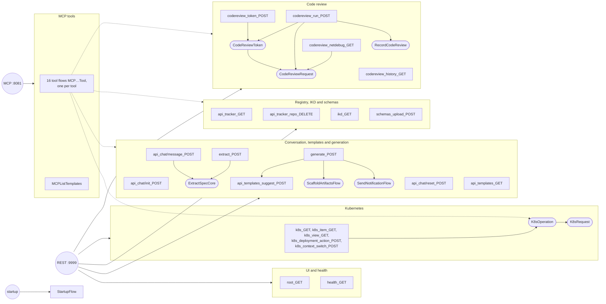

# Flows

The app has 48 flows. Each REST operation and MCP tool starts one flow (an arrow to a group means every flow in it has
its own operation); the rounded boxes are subflows, called only by other flows. The MCP tool flows run the flows of the
REST operations as subflows (dotted arrows):

| Area | Flow | Started by | Role |
|------|------|------------|------|
| Startup | `StartupFlow` | app startup hook | Loads the catalog, IKD ids, operations programs and Kubernetes contexts into shared data, creates or upgrades the PostgreSQL tables, creates the Weaviate collection and ingests the catalog |
| UI | `root_GET` | `GET /` | Returns the web UI (`static/chat-github.html`) |
| UI | `health_GET` | `GET /health` | Liveness and readiness answer |
| Conversation | `api_chat/init_POST` | `POST /api/chat/init` | Creates a session (id and greeting) in `chat_session` |
| Conversation | `api_chat/message_POST` | `POST /api/chat/message` | One chat turn: loads the session, extracts fields (`ExtractSpecCore`), merges them into the spec (a field keeps its first value, as in the reference), lists the missing fields, saves the session and replies |
| Conversation | `api_chat/reset_POST` | `POST /api/chat/reset` | Deletes the session |
| Conversation | `extract_POST` | `POST /extract`, MCP `extract_spec` | One-shot extraction merged with an optional `current_spec`; reports the missing fields |
| Conversation | `ExtractSpecCore` | subflow of `api_chat/message_POST` and `extract_POST` | Rule engine pre-extraction (`rules/nlu-extraction.yaml`), LLM extraction (`EXTRACTION_SYSTEM_PROMPT`), JSON clean-up and parsing |
| Templates | `api_templates_GET` | `GET /api/templates` | The catalog from shared data |
| Templates | `api_templates_suggest_POST` | `POST /api/templates/suggest`, subflow of `generate_POST` | Weaviate hybrid search (BM25 and vector) over the catalog; ranked suggestions |
| Generation | `generate_POST` | `POST /generate`, MCP `generate_code` | The generation pipeline: naming, validation, IKD check, duplicate check, template selection, scaffolding, registry and IKD registration, e-mail ([gates](how-it-works.md#generation-gates)) |
| Generation | `ScaffoldArtifactsFlow` | subflow of `generate_POST` | Renders the CI/CD files and runs the Git Repo Scaffolder: materializes the template and publishes everything in one commit, to a folder of the shared repository or a new repository |
| Generation | `SendNotificationFlow` | subflow of `generate_POST` | HTML e-mail rendered from a template ([Notification e-mail](configuration.md#notification-e-mail)), full repository or config-only variant, with the inline logo, sent over SMTP |
| Registry | `api_tracker_GET` | `GET /api/tracker` | The newest 100 registrations with their GitHub location, plus the template source and UI settings |
| Registry | `api_tracker_repo_DELETE` | `DELETE /api/tracker/{repo_name}` | [Cleanup](how-it-works.md#where-the-code-is-published): deletes the folder in one commit (shared repository) and the registry and IKD rows |
| Registry | `ikd_GET` | `GET /api/ikd` | The IKD registry in the reference `IKD_*.txt` format |
| Schemas | `schemas_upload_POST` | `POST /api/schemas/upload/{kind}` | Plans the upload, finds the registration, checks the XML and commits the files ([sequence](operations.md#schema-upload)) |
| Kubernetes | `k8s_GET`, `k8s_item_GET`, `k8s_view_GET`, `k8s_deployment_action_POST`, `k8s_context_switch_POST` | `GET`/`POST /k8s/...` | Pass the route and its parameters to `K8sOperation` |
| Kubernetes | `K8sOperation` | subflow of the `k8s_*` flows | Routes to an operation, plans the API calls (jq programs), runs them through `K8sRequest` and shapes the reference response; a context switch updates `APP_K8S` |
| Kubernetes | `K8sRequest` | subflow of `K8sOperation` | REST Invoke `GET` or `PATCH` to the Kubernetes API; never fails (a transport error comes back with status 0) |
| Code review | `codereview_token_POST` | `POST /api/codereview/token` | Returns the cached or a fresh session token |
| Code review | `codereview_run_POST` | `POST /api/codereview/run` | Checks the request, gets the token, runs the review with one retry on a fresh token, records the run ([sequence](operations.md#code-review)) |
| Code review | `codereview_history_GET` | `GET /api/codereview/history` | Run history, newest first |
| Code review | `codereview_netdebug_GET` | `GET /api/codereview/network-debug` | Probes the service and reports DNS, TCP, TLS and HTTP reachability |
| Code review | `CodeReviewToken` | subflow | Token cache in `APP_CODEREVIEW`; fetches `getsession.jsp` when missing or forced; 503 while the credentials are not set |
| Code review | `CodeReviewRequest` | subflow | REST Invoke `Probe`, `Get`, `PostForm` or `PostJson` to the service; never fails |
| Code review | `RecordCodeReview` | subflow | Appends a run to `code_review_history` (keeps the newest 500) |
| MCP | `MCPChatTool`, `MCPChatResetTool`, `MCPExtractSpecTool`, `MCPSuggestTemplatesTool`, `MCPGenerateTool`, `MCPListRepositoriesTool`, `MCPDeleteRepositoryTool`, `MCPGetIKDRegistryTool`, `MCPUploadSchemasTool`, `MCPK8sGetTool`, `MCPK8sDeploymentActionTool`, `MCPK8sSwitchContextTool`, `MCPCodeReviewTokenTool`, `MCPCodeReviewRunTool`, `MCPCodeReviewHistoryTool`, `MCPCodeReviewNetworkCheckTool` | one [MCP tool](mcp.md) each | Run the flow of the matching REST operation as a subflow (the Kubernetes tools run `K8sOperation`) and return its body; a status of 400 or higher becomes a tool error |
| MCP | `MCPListTemplates` | MCP `list_templates` | The catalog from shared data |
