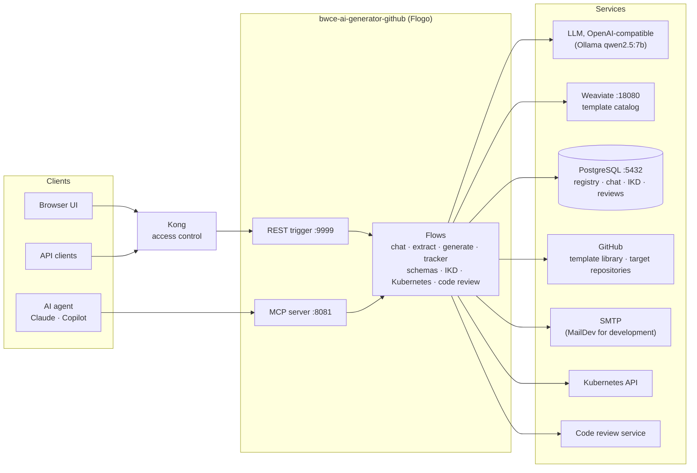
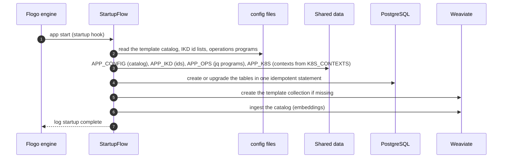
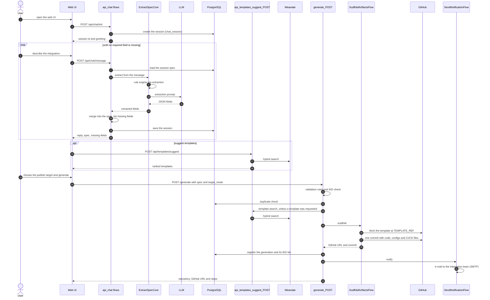
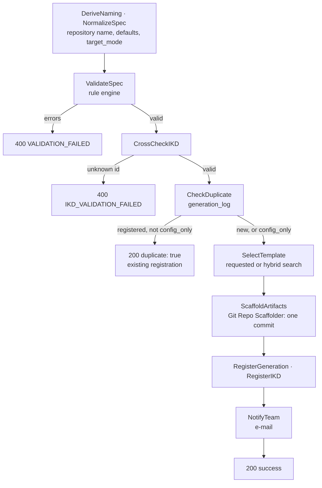
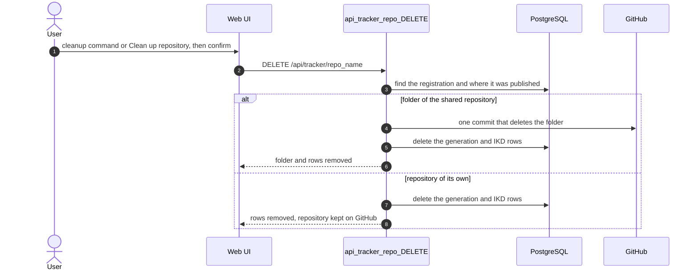

# How it works

## Architecture

## Startup

When the app starts, `StartupFlow` prepares everything the request flows read, so no request reads a configuration
file or creates a table:

## From conversation to repository

The typical journey in the web UI: the chat collects the integration spec turn by turn, then `POST /generate`
publishes the repository. API clients do the same with `POST /extract` (one shot) and `POST /generate`; AI agents use
the [MCP tools](mcp.md).

## Generation gates

`POST /generate` (the UI's Generate step and the MCP tool `generate_code`) is a chain of gates; nothing is written
until every gate has passed.

| Gate | Check | On failure |
|------|-------|------------|
| Validation | `rules/spec-validation.yaml`: required fields, repository name ≤ 50 characters, e-mail domain, … | 400 `VALIDATION_FAILED` with details, no writes |
| IKD | `interface_id` / `scenario_id` exist in the IKD lists | 400 `IKD_VALIDATION_FAILED` |
| Idempotency | no registration for the repository name yet (unless `config_only`) | 200 with the existing registration |
| Race safety | `UNIQUE(repo_name)` + `ON CONFLICT` | concurrent duplicates collapse to one row |

A runtime fault (for example PostgreSQL down) is caught by the flow's error handler: 500 `INTERNAL_ERROR` with the
failing activity and message.

**Repository name:** `[in<area>-]src-object-target[-uid][-country]-itype` (product-area prefix map,
`REST_SERVICE`/`SOAP_SERVICE` → `service`).
**Generated content:** `code/<repo>/…` (the template project with its tokens replaced and paths renamed),
`configs/generation.properties`, `configs/generation-metadata.json` and the CI/CD files `.github/workflows/ci.yml`,
`Jenkinsfile`, `k8s/deployment-<env>.yaml` and `config/runtime-<env>.json` (templates in `config/ops-programs.json`,
off with `GENERATE_CICD=false`). `config_only: true` refreshes only `configs/` and keeps the code.
**IKD registry:** every generation registers `<interface_id>:<repo>` / `<scenario_id>:<repo>` in `ikd_registry`
(replacing the repository's previous entry; skipped for config-only).

## Where the code is published

| `target_mode` | Result |
|---------------|--------|
| `subfolder` (default) | folder `<repo>/` in the shared repository `TARGET_REPO_URL`, branch `TARGET_BRANCH` |
| `newRepo` | new private repository `<repo>` under `TARGET_OWNER_URL` |

`TARGET_MODE` sets the default; a request overrides it with `target_mode` (REST `/generate`, MCP `generate_code`, UI).
The registry stores where each repository went, so links, duplicate answers, config-only refreshes, schema uploads and
cleanup keep following the repository when the default changes later.

The repository name is derived from the spec, so **the same spec maps to the same repository**: `/generate` answers
`duplicate: true` with the existing registration and changes nothing. In the UI, a new request after a generation
starts a new conversation.

**New repository from the UI:** describe the integration in the chat, choose **🆕 New repository** after the
product-area step (or type `/newrepo` at any time; `/shared` switches back), then generate; the result links the new
repository.

**Cleanup:** `DELETE /api/tracker/{repo_name}` (UI: `/cleanup <repo>` or **🧹 Clean up repository**) deletes the
folder from the shared repository in one commit and removes the registry and IKD rows. A repository of its own is kept
on GitHub (deleting a repository cannot be undone and needs extra token rights); delete it there by hand.

