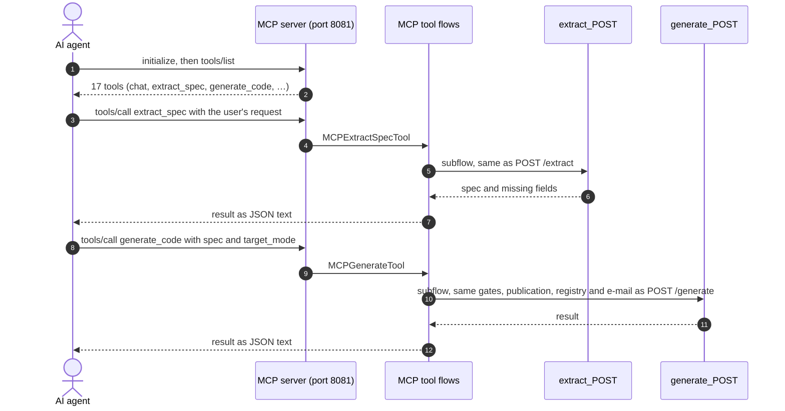

# MCP server

Streamable HTTP at `http://<host>:8081/mcp`. VS Code (`.vscode/mcp.json`):

```json
{ "servers": { "bwce-ai-generator": { "type": "http", "url": "http://localhost:8081/mcp" } } }
```

Cursor: `{ "mcpServers": { "bwce-ai-generator": { "url": "http://localhost:8081/mcp" } } }`. Clients that only speak stdio
(for example Claude Desktop) can bridge with `npx mcp-remote http://localhost:8081/mcp`.

Every feature of the web UI and the REST API is a tool, so an agent can do what a user can: build the spec, generate,
upload schemas, check and scale the deployment, run a code review and clean up. Each tool runs the flow of its REST
operation as a subflow, so the gates, writes and answers are the same; the arguments are the request body (and path
or query parameters).

| Tool | REST operation | Arguments | Result |
|------|----------------|-----------|--------|
| `chat` | `POST /api/chat/init` and `/api/chat/message` | `message` (required), `session_id` (from the previous result; omit it to start a conversation) | the reply, the spec so far, `missing_fields`, `ready_to_generate`, `session_id` |
| `chat_reset` | `POST /api/chat/reset` | `session_id` | confirmation |
| `extract_spec` | `POST /extract` | `message` (required), `current_spec` (the spec so far, for follow-up turns) | the extracted spec, missing fields, `ready_to_generate` |
| `list_templates` | `GET /api/templates` | — | the template catalog |
| `suggest_templates` | `POST /api/templates/suggest` | any of `source_system`, `target_system`, `business_object`, `interface_type`, `query` | ranked templates |
| `generate_code` | `POST /generate` | `spec` (required: `source_system`, `target_system`, `business_object`, `interface_type`), `config_only`, `target_mode` (`subfolder` or `newRepo`), `context` (conversation text for the template choice) | the generation result: same pipeline, registry and notification |
| `list_repositories` | `GET /api/tracker` | — | `count` and the registry with GitHub locations, the template source and the publishing settings |
| `delete_repository` | `DELETE /api/tracker/{repo_name}` | `repo_name` | the cleanup result |
| `get_ikd_registry` | `GET /api/ikd` | `kind` (`InterfaceIDs` or `ScenarioIDs`) | `<id>:<repository>` lines |
| `upload_schemas` | `POST /api/schemas/upload/batch` | `repository_name`, `source_schemas`, `target_schemas` (each a list of `filename` and `content`) | the committed files and the commit |
| `k8s_get` | `GET /k8s/{resource}`, `/k8s/{resource}/{name}`, `/k8s/{resource}/{name}/{view}` | `resource` (required), `name`, `view` (`rollout`, `logs`, `port-forward`) and the query parameters (`app_label`, `label_selector`, `limit`, `tail`, `previous`, `local_port`, `pod_port`) | health, context, status, a list, one deployment or pod, rollout status, logs or the port-forward command |
| `k8s_deployment_action` | `POST /k8s/deployments/{name}/{action}` | `name`, `action` (`scale` or `restart`), `replicas` (for scale) | the action result |
| `k8s_switch_context` | `POST /k8s/context/switch` | `context` | the new context |
| `code_review_token` | `POST /api/codereview/token` | — | the user and user type (never the token) |
| `code_review_run` | `POST /api/codereview/run` | `repoName`, `productName`, `version` (required), `checkbwdesign` | the status and report links |
| `code_review_history` | `GET /api/codereview/history` | — | the runs, newest first |
| `code_review_network_check` | `GET /api/codereview/network-debug` | — | DNS, TCP, TLS and HTTP checks |

The result is the REST response body as JSON text (the IKD export as plain text). A status of 400 or higher makes the
result a tool error (`isError`) with the same body, for example `VALIDATION_FAILED` and its details. The tools carry
MCP hints: the reads are read-only, and `delete_repository`, `chat_reset` and `k8s_deployment_action` are marked
destructive, so clients can ask for confirmation first. The MCP server has no authentication of its own and offers
write tools (generation, cleanup, scaling): keep `:8081` internal or behind Kong, like the REST port (see
[Access control](deployment.md#access-control-kong)).



Try the tools interactively with the MCP Inspector: `npx @modelcontextprotocol/inspector`, then connect to
`http://localhost:8081/mcp` (Streamable HTTP).
