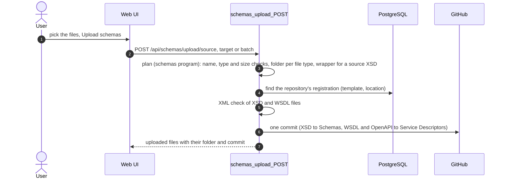
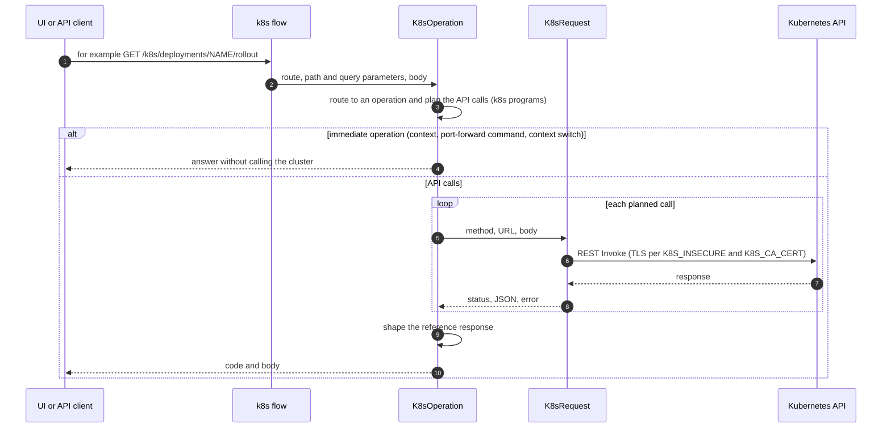
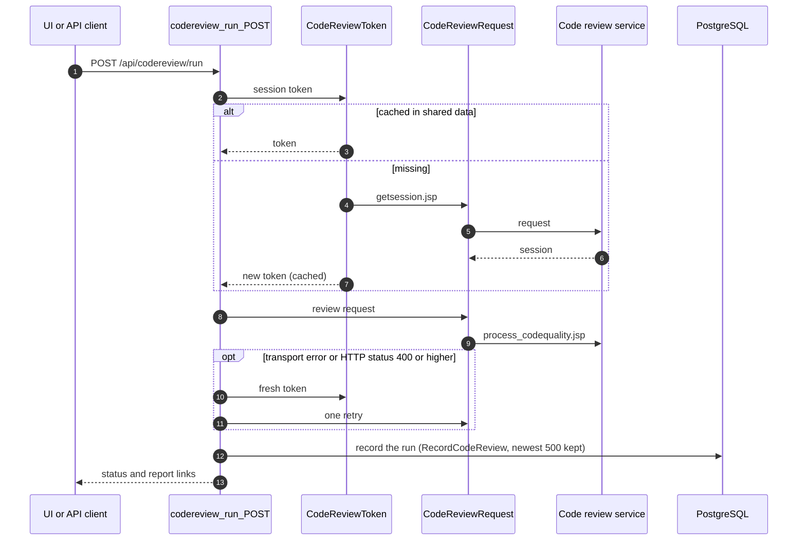

# Operations

All logic is Flogo flows; data-shaped logic (Kubernetes request planning and response mapping, code review, schema
upload planning, CI/CD and e-mail rendering) runs
as **jq programs** (TIBCO `json.jq`) loaded at startup from `config/ops-programs.json` into shared data, so one
generic flow serves many endpoints. Only OOTB activities are used (REST Invoke, PostgreSQL, Shared Data,
XML-to-JSON, Mapper) plus the Git Repo Scaffolder. Outbound HTTP goes through two subflows built from the OOTB
**Invoke REST Service** activity, one per target system:

| Subflow | Invokes (method, timeout) | TLS |
|---------|---------------------------|-----|
| `K8sRequest` | `Get` (GET, 30 s), `Patch` (PATCH merge patch, 30 s) | `K8S_INSECURE`, `K8S_CA_CERT` |
| `CodeReviewRequest` | `Probe` (GET, 6 s), `Get` (GET, 25 s), `PostForm` (form POST, 25 s), `PostJson` (JSON POST, 120 s) | `CODE_REVIEW_INSECURE` |

Method, request type and timeout are fixed per Invoke (the designer only offers them as literals), so the subflow
picks the Invoke from its inputs. The Settings URL is the default endpoint; the URL planned at runtime (path and
query) is mapped to the Invoke's `serviceUrl` input, which overrides it. A transport failure (DNS, TCP, TLS,
timeout) takes the error link to `Failed`, so both subflows always return `status`, `text`, `json`,
`content_type`, `elapsed_ms` and `error` (status 0 on a transport failure).

| Area | Endpoints | Notes |
|------|-----------|-------|
| Kubernetes | `GET /k8s/{resource}` (health, context, status, deployments, pods, services, events), `GET /k8s/{resource}/{name}`, `GET /k8s/{resource}/{name}/{view}` (rollout, logs, port-forward), `POST /k8s/deployments/{name}/{action}` (scale, restart), `POST /k8s/context/switch` | Same URLs as the reference; the route selects the operation (`k8s.routes` in `config/ops-programs.json`, anything else is 404). Calls the Kubernetes REST API directly (no kubectl) with the response shapes of the reference; contexts from `K8S_CONTEXTS` (JSON: url, namespace, token; TLS for all contexts from `K8S_INSECURE` and `K8S_CA_CERT`); `GET /k8s/context` also lists the configured context names (`contexts`, never their URLs or tokens); restrict the `POST` routes (scale, restart, switch) in Kong if only operators may use them |
| Code review | `POST /api/codereview/token`, `POST /api/codereview/run`, `GET /api/codereview/history`, `GET /api/codereview/network-debug` | intginvent token cached in shared data, one retry with a refreshed token, history (newest 500) in PostgreSQL, report links extracted and query strings redacted |
| Schemas | `POST /api/schemas/upload/{kind}` (source, target, batch) | JSON body (`repository_name`, `filename`, `content` / `source_schemas[]`, `target_schemas[]`); source: `.xsd`; target: `.xsd`, `.wsdl` or OpenAPI/Swagger (`.json`, `.yaml`, `.yml`); XSD/WSDL must be well-formed XML and OpenAPI/Swagger files must declare `openapi` or `swagger`; every file is committed in one commit, XSDs into `code/<repo>/<repo>.module/Schemas`, WSDL and OpenAPI/Swagger files into `code/<repo>/<repo>.module/Service Descriptors`; a source XSD gets the reference `adidasIntegrationMessage.xsd` wrapper |

## Schema upload

## Kubernetes

## Code review

