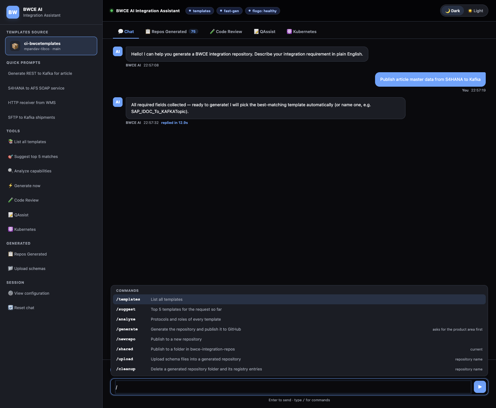
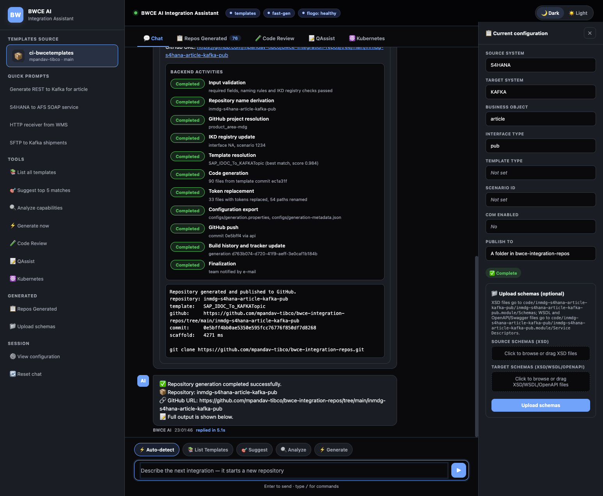
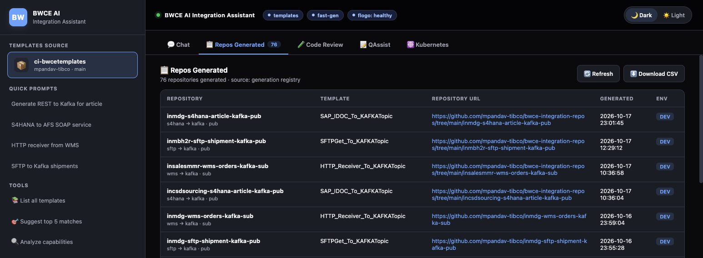
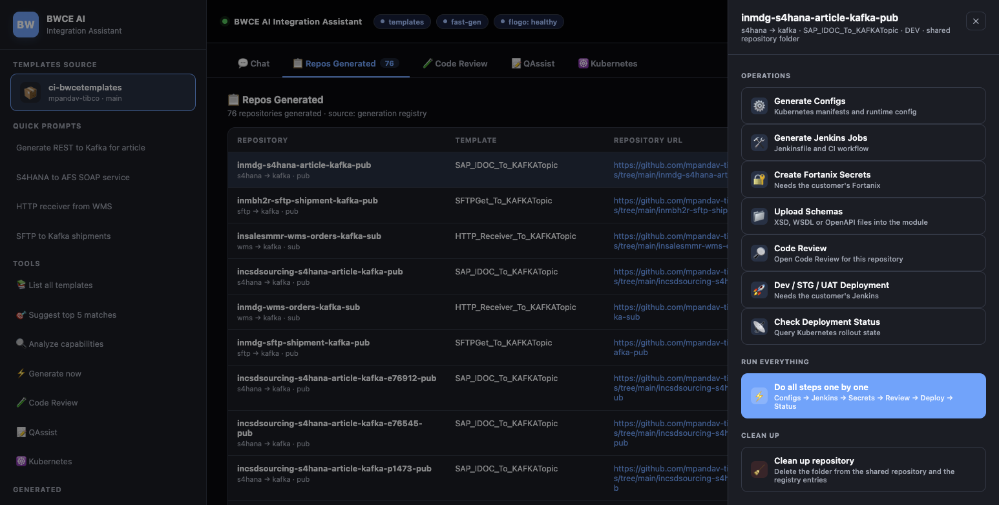
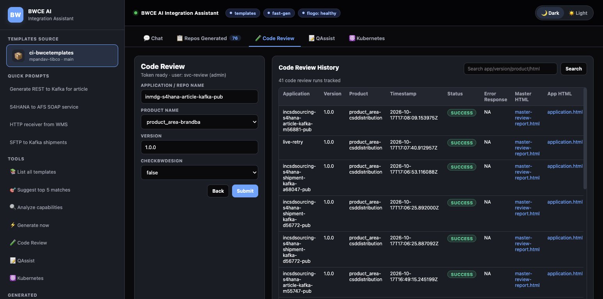
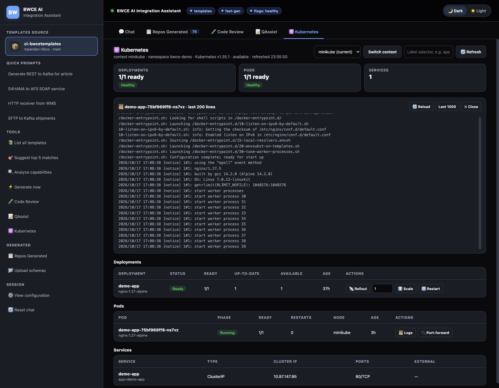

# Web UI

`GET /` serves `static/chat-github.html`, read on every request (UI changes need no rebuild). Its tabs are Chat,
Repos Generated, Code Review, QAssist (opens `QASSIST_URL`) and Kubernetes; the sidebar has quick prompts and
shortcuts to the same features. The screenshots come from a development setup (a local minikube cluster and a test
code review service).

## Chat

Quick prompts and the commands `/templates`, `/suggest`, `/analyze`, `/generate`, `/newrepo`, `/shared`,
`/upload <repo>` and `/cleanup <repo>`. Typing `/` opens a command menu that shows what each command would do at that
moment (for example the fields `/generate` still needs) and offers repository names for `/upload` and `/cleanup`.

`/generate` asks for the product area and where to publish, then shows each backend step and the published
repository. The configuration drawer shows the spec and takes schema files (several source and target files at
once, committed together; also opened from the sidebar and from a repository's actions).

## Repos Generated

The registry with GitHub links and repository actions: schema upload, deployment status, code review, links to the
generated Kubernetes, configuration and Jenkins files, and cleanup. The Jenkins and Fortanix steps need the customer's
systems.

## Code Review

A review run for a generated repository (application, product, version) and the history of runs with links to the
master and application reports.

## Kubernetes

The cluster of the current context: health, a context picker (switching asks for confirmation and applies to every
user until it is switched back or the app restarts), deployments (rollout status, scale, rolling restart), pods (logs,
logs of the previous container, the `kubectl port-forward` command), services and recent events, optionally filtered
by a label selector. It uses the `/k8s` endpoints, so without `K8S_CONTEXTS` it shows that Kubernetes is not
configured.

